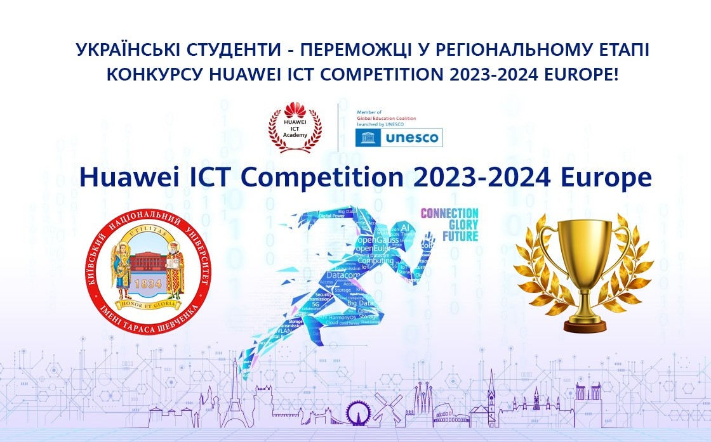

On 20 March 2024, the Taras Shevchenko National University of Kyiv team LAN Lords won the online competition of the Huawei ICT Competition, taking first place in Ukraine with the highest scores, as well as third place in the European region. The winning students have been invited to Türkiye for the award ceremony, which will take place on 24-26 April 2024. At the award ceremony it will be announced who exactly will travel to the final stage of the competition in China in May, where the teams will compete for the main prize against rivals from leading universities around the world.

<https://www.huawei.com/ua/news/ua/2024/huawei%20ict%20competition%20results%200324>
