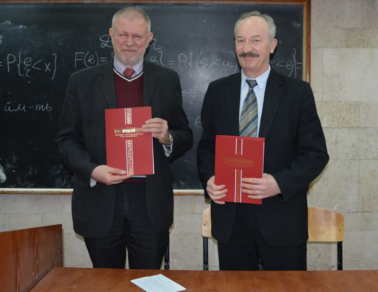
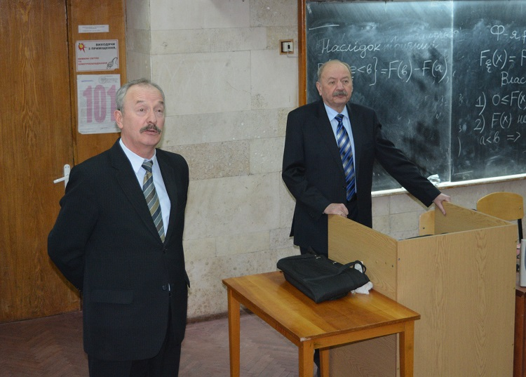

On 10 March 2017, the faculty hosted IBM Day. A Memorandum of Understanding was signed between the Faculty of Radiophysics, Electronics and Computer Systems of Taras Shevchenko National University of Kyiv and IBM Ukraine LLC. The event was preceded by the transfer of an IBM System p5 550 server to the staff of the Department of Computer Engineering so that students and PhD students could study IBM technologies in depth.

Oleksandr Danko, Director of the Academic Initiatives Department at IBM, gave a talk entitled "The History of Innovation at IBM. The Evolution of the IT Industry. The Fourth Technological Revolution. The Era of Cognitive Computing". Alla Sobolievska then spoke on behalf of the company, presenting the latest IBM computer systems and solutions.

Head of the Department Professor Serhii Pohorilyi thanked the company's representatives for their technical support and expressed hope for further creative cooperation.
