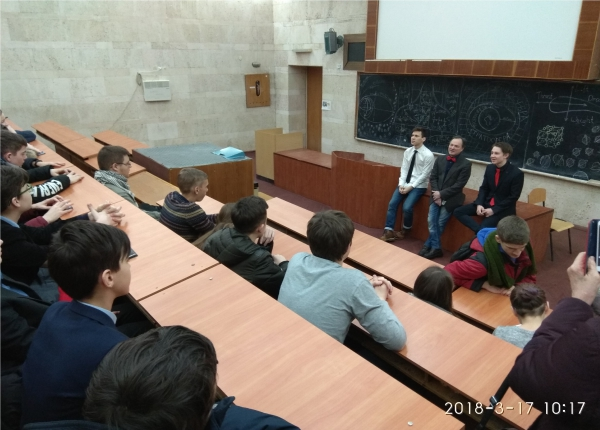
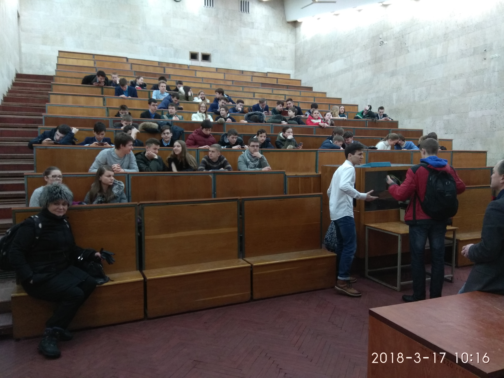

On 16 March 2018, the Faculty of Radiophysics, Electronics and Computer Systems held its Open Day. The programme included an intellectual brain-ring quiz and a quest tour of the most interesting corners of the faculty. Despite the unfavourable weather, more than 50 pupils from different parts of Ukraine came to the events.

The Department of Computer Engineering warmly opened its doors to future applicants. During the tour, Associate Professor O. S. Bauzha showed the pupils the department's modern and comfortable teaching laboratories and gave an engaging presentation of the speciality "Computer Engineering".

