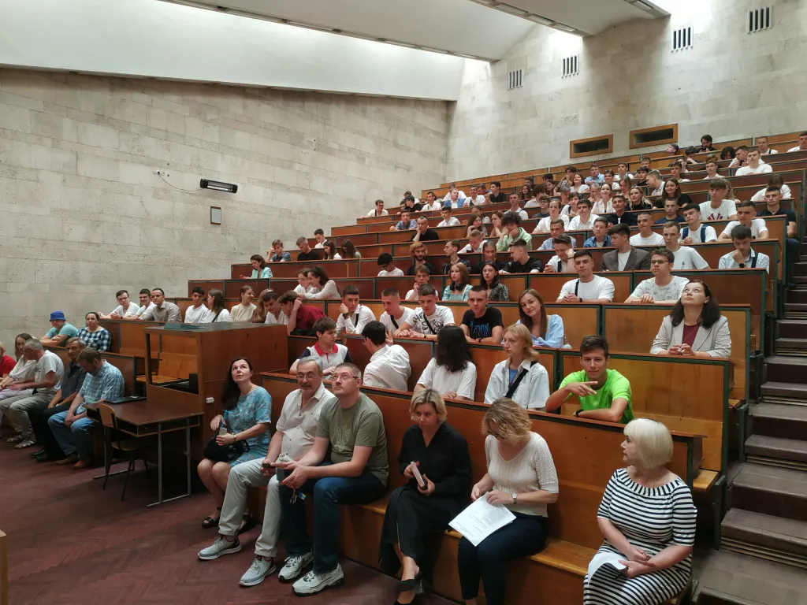

On 1 September 2023, the Faculty of Radiophysics, Electronics and Computer Systems held a welcome ceremony for first-year Bachelor's students and their parents. The event took place in an exceptionally solemn, yet warm and moving atmosphere. Heartfelt wishes to the faculty's students were expressed by the Dean of the Faculty Andrii Netreba, the Heads of Departments Yurii Boiko, Serhii Radchenko, Serhii Savenkov and Hanna Karlash, the Deputy Deans Nataliia Bashmakova, Yuliia Veremii and Nataliia Horbovtsova, as well as the faculty's curators and lecturers.

Dear first-year students! Congratulations on joining the KNU family! Today you have moved one more step closer to making your dream come true: new opportunities and prospects are opening up before you, and they will become the foundation of your future. We hope that at the university you will find true friends and like-minded people.

Our warmest congratulations! Have happy student years!
