The Sinners of the networks team from Taras Shevchenko National University of Kyiv took **first place** in the Datacom Engineering category of Student Tech Challenge-2026, a nationwide team competition held by Huawei Ukraine. The winners were awarded on 6 November 2026 in Kyiv.

42 teams from 18 universities in 12 Ukrainian cities took part in the competition. The tasks were set in three categories: Datacom Engineering, Digital Energy and Radio Access Network Planning. The teams presented their projects to an independent jury on 4–5 November 2026.

The team consisted of students of the Department of Computer Engineering: fourth-year students Viktoriia Semeniakina, Maksym Kuzmenko, Andrii Pikulia and Hlib Kobryn, and third-year student Ivan Tsyvinskyi. The team was supervised by Assistant Professor [V. A. Marianovskyi](/personas/marianovskyi), PhD in Engineering.

Prize-winners in the Datacom Engineering category:

- 1st place — Sinners of the networks, Taras Shevchenko National University of Kyiv;
- 2nd place — SYNergy, Lviv Polytechnic National University;
- 3rd place — 17_channel_2.4, a joint team of the State University of Information and Communication Technologies and the National University of Life and Environmental Sciences of Ukraine;
- 3rd place — Cluster, Borys Grinchenko Kyiv Metropolitan University.

The Department of Computer Engineering congratulates the team on its victory.

About the competition: <https://techchallenge.com.ua/>

Taras Shevchenko National University of Kyiv on Facebook: [Students of #ТвійКНУ won the nationwide engineering competition Student Tech Challenge 2026](https://www.facebook.com/kyiv.university/posts/-%D1%81%D1%82%D1%83%D0%B4%D0%B5%D0%BD%D1%82%D0%B8-%D1%82%D0%B2%D1%96%D0%B9%D0%BA%D0%BD%D1%83-%D0%BF%D0%B5%D1%80%D0%B5%D0%BC%D0%BE%D0%B3%D0%BB%D0%B8-%D0%BD%D0%B0-%D0%B2%D1%81%D0%B5%D1%83%D0%BA%D1%80%D0%B0%D1%97%D0%BD%D1%81%D1%8C%D0%BA%D0%BE%D0%BC%D1%83-%D1%96%D0%BD%D0%B6%D0%B5%D0%BD%D0%B5%D1%80%D0%BD%D0%BE%D0%BC%D1%83-%D0%BA%D0%BE%D0%BD%D0%BA%D1%83%D1%80%D1%81%D1%96-student-tech/1639123161590369/) (in Ukrainian).

**Photo gallery.** Click any photo to open it in full resolution.

[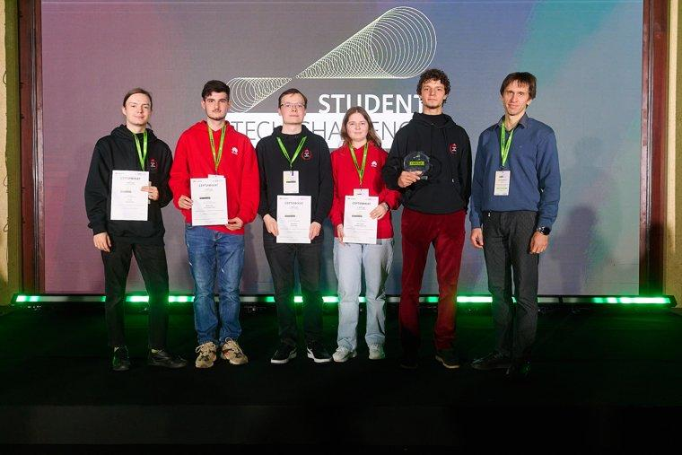](/files/stc2026/stc-2026-01.jpg)

[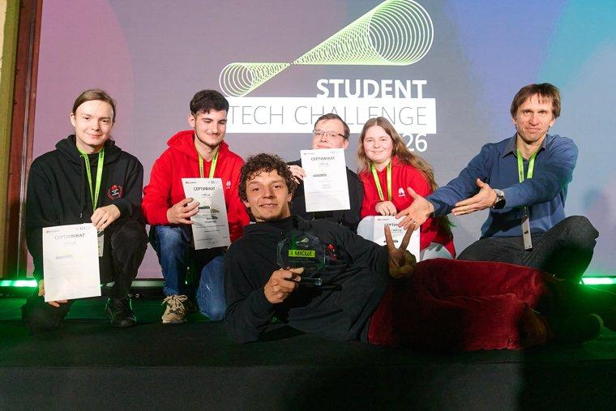](/files/stc2026/stc-2026-02.jpg)

[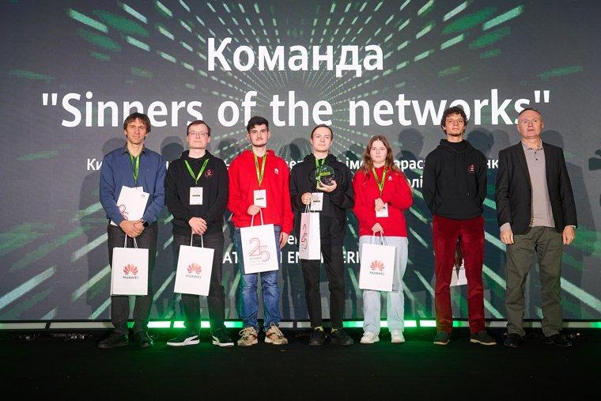](/files/stc2026/stc-2026-03.jpg)

[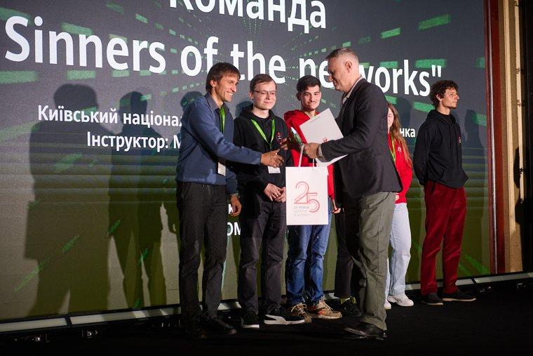](/files/stc2026/stc-2026-04.jpg)

[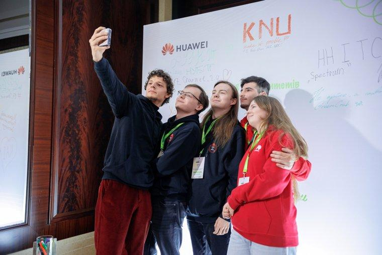](/files/stc2026/stc-2026-05.jpg)

[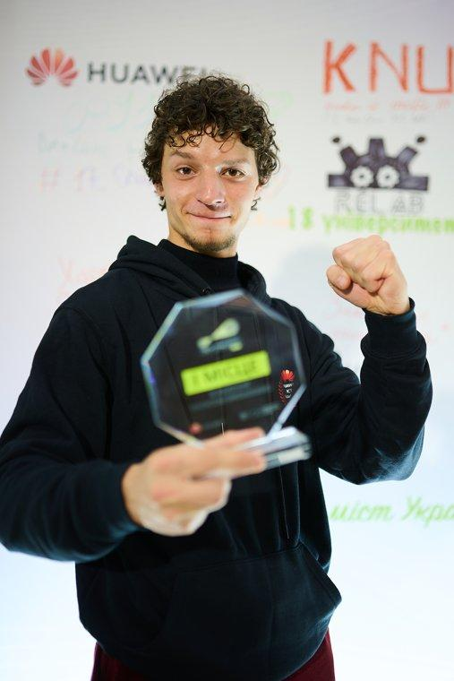](/files/stc2026/stc-2026-06.jpg)

[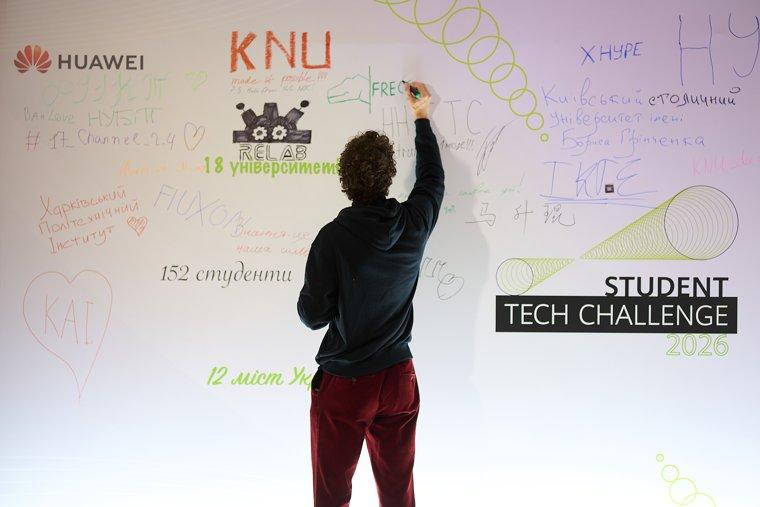](/files/stc2026/stc-2026-07.jpg)

[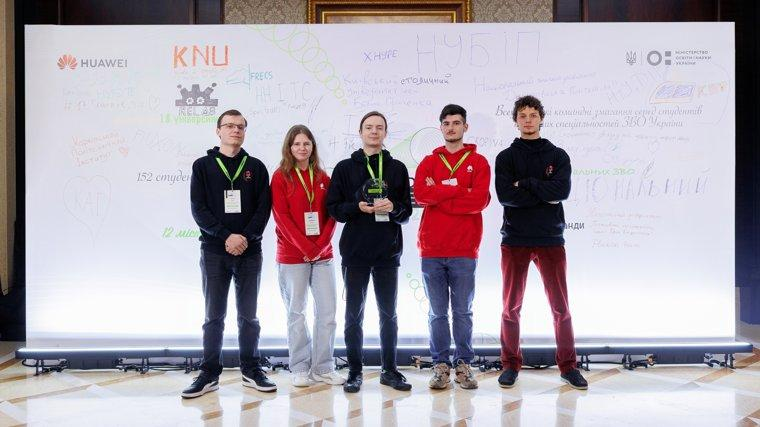](/files/stc2026/stc-2026-08.jpg)

[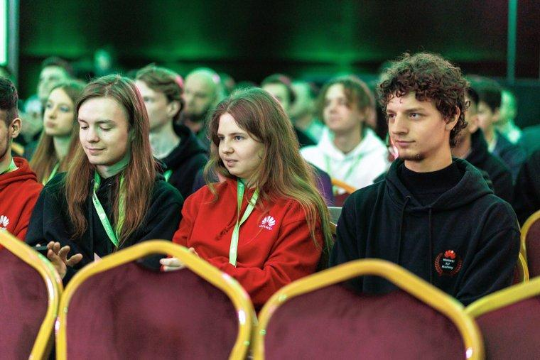](/files/stc2026/stc-2026-09.jpg)

[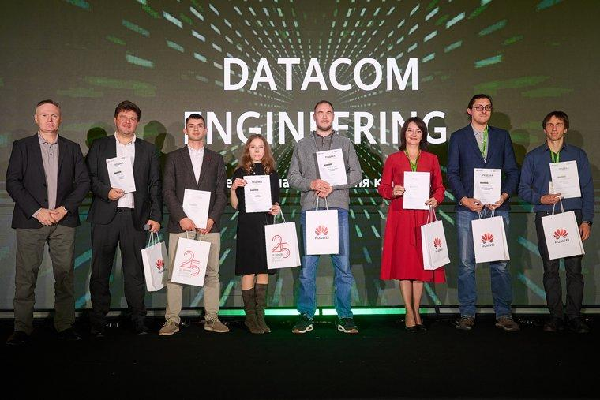](/files/stc2026/stc-2026-10.jpg)

[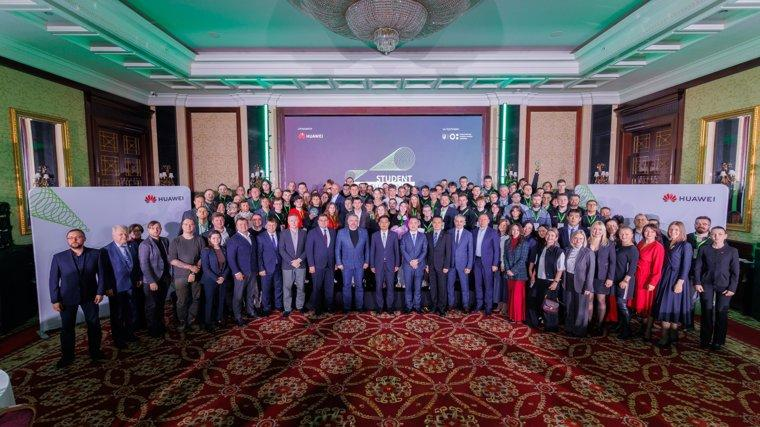](/files/stc2026/stc-2026-11.jpg)

[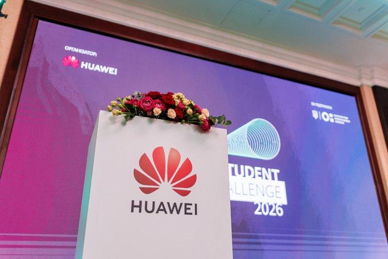](/files/stc2026/stc-2026-12.jpg)

[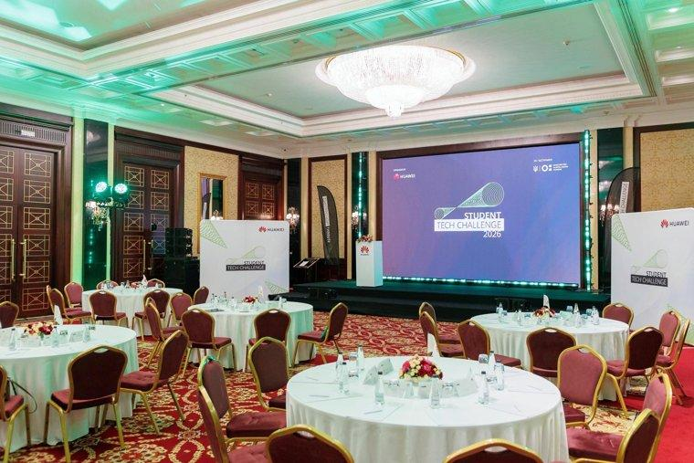](/files/stc2026/stc-2026-13.jpg)

[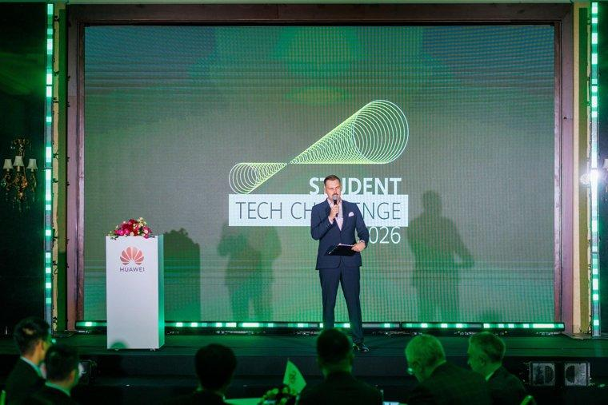](/files/stc2026/stc-2026-14.jpg)

[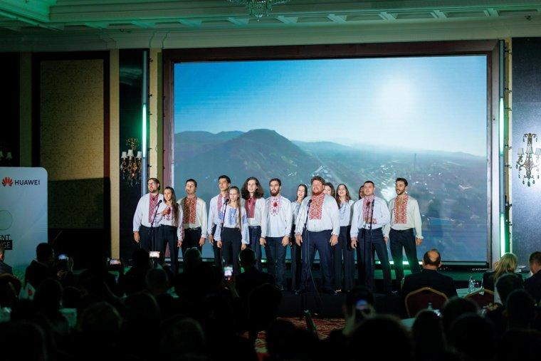](/files/stc2026/stc-2026-15.jpg)

