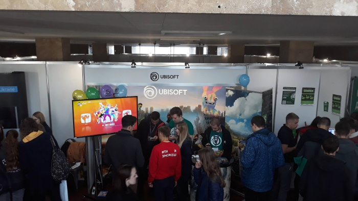

On 10 October 2018, a job fair was held on the faculty premises.

Leading firms from various sectors were represented, from metallurgical and agricultural companies to banks and representatives of the gaming industry. Among those present were Ubisoft, Raiffeisen Bank Aval, Lifecell, Ukrenergo and others.

Regardless of its field of activity, each company was interested in finding qualified IT specialists, since no modern production process is possible without automated and computer systems. Given this, as well as the high quality of training, graduates of our department (CE) have broad opportunities to find well-paid jobs
