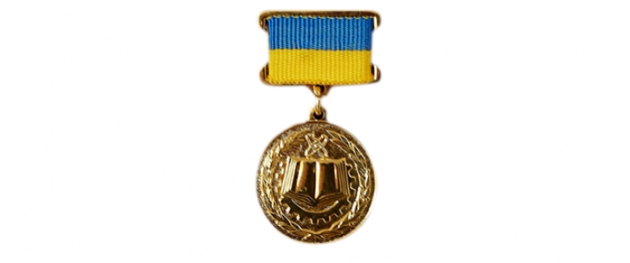

By Decree of the President of Ukraine, two members of staff of the Department of Computer Engineering have received the country's highest award in their field for the research work "Methods and Novel Approaches to the Design, Management and Application of High-Performance IT Infrastructures".

The main result of the work is the formation of a coherent, scientifically grounded methodology for supporting the processes of designing, managing and using IT infrastructure. Within this methodology, the theoretical foundations have been developed for the first time for designing and analysing the properties of mathematical models of IT infrastructures and their services based on transition systems, their synchronous products, Petri nets, finite automata, and classical and non-classical logics. An applied schematology of algorithmic support for distributed supercomputer architectures has been created, which makes it possible to design algorithms for operation in a distributed environment using rigorous mathematical methods.

The results of the work have been used in building components of IT infrastructures at the Ministry of Defence of Ukraine, the Office of the National Security and Defence Council of Ukraine, the State Emergency Service of Ukraine, the Secretariat of the Cabinet of Ministers of Ukraine, the Prosecutor General's Office of Ukraine and other state bodies, at leading higher education institutions of Ukraine, and at business organisations around the world: Optus (Australia); Singtel (Singapore), KDDI (Japan); TE Data (Egypt); Navigator LLC (Ukraine), T-Mobile (Czech Republic); Sprint, Suddenlink (USA), Telus, Bell Canada (Canada).

The work was carried out by a team of eight leading Ukrainian scientists in the field of information technology: Serhii Demianovych Pohorilyi, Doctor of Science in Engineering (D.Sc.), Head of Department at Taras Shevchenko National University of Kyiv; Serhii Lukianovych Kryvyi, Doctor of Science in Physics and Mathematics (D.Sc.), Professor at Taras Shevchenko National University of Kyiv; Viktor Mykolaiovych Volokhov, PhD in Physics and Mathematics (Candidate of Sciences), Associate Professor at Taras Shevchenko National University of Kyiv; Yurii Volodymyrovych Boiko, PhD in Physics and Mathematics (Candidate of Sciences), Associate Professor at Taras Shevchenko National University of Kyiv; Serhii Fedorovych Telenyk, Doctor of Science in Engineering (D.Sc.), Dean at the National Technical University of Ukraine "Igor Sikorsky Kyiv Polytechnic Institute"; Oleksandr Ivanovych Rolik, Doctor of Science in Engineering (D.Sc.), Head of Department at the National Technical University of Ukraine "Igor Sikorsky Kyiv Polytechnic Institute"; Mykola Mykolaiovych Hlybovets, Doctor of Science in Physics and Mathematics (D.Sc.), Dean at the National University of Kyiv-Mohyla Academy; Volodymyr Mykolaiovych Opanasenko, Doctor of Science in Engineering (D.Sc.), Leading Researcher at the V. M. Glushkov Institute of Cybernetics of the National Academy of Sciences of Ukraine.

The staff of the Department of Computer Engineering warmly congratulate the Head of the Department, Professor S. D. Pohorilyi, and the Director of the Computing Centre (ICC), Associate Professor Yu. V. Boiko, on being awarded the 2018 State Prize of Ukraine in Science and Technology (Decree of the President of Ukraine No. 110/2019 of 8.04.2019) and wish them further creative success!
