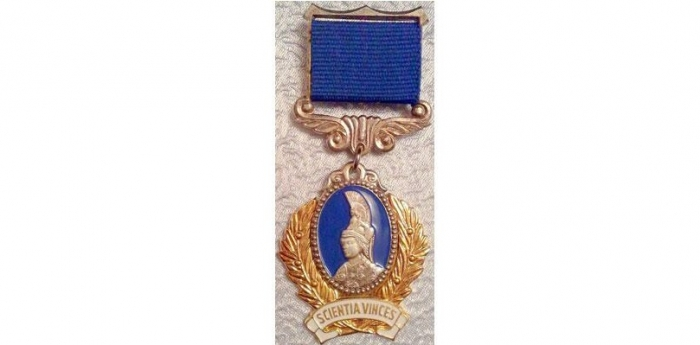

[By Decree of the President of Ukraine](https://www.president.gov.ua/documents/4192018-25730), two members of staff of the Department of Computer Engineering have received a high national award in their field for the research work "[Creation of a High-Performance Grid Infrastructure for Research into Conformational Changes of Biopolymers](http://www.kdpu-nt.gov.ua/work/stvorennya-visokoproduktivnoyi-infrastrukturi-v-grid-dlya-doslidzhen-konformaciynih-zmin-biopol)".

The main result of the work is the creation of an integrated information and computing platform, which has made it possible to significantly increase computational efficiency in computer-based studies of biological macromolecules and their complexes. Significant new results have been obtained on the structure and structural dynamics of human tyrosyl-tRNA synthetase and of complexes formed with the participation of this enzyme, as well as on the molecular mechanisms by which mutations associated with Charcot-Marie-Tooth neuropathy exert their effects.

The data presented deepen the existing understanding of the molecular mechanisms of aminoacyl-tRNA synthetase function and open the way for further experimental research.

The work was carried out by a team of three leading Ukrainian scientists in the fields of information technology and bioinformatics: Oleksandr Viacheslavovych Savytskyi, PhD in Biology (Candidate of Biological Sciences), Senior Researcher at the Institute of Molecular Biology and Genetics of the National Academy of Sciences of Ukraine; Andrii Oleksandrovych Salnikov, PhD in Engineering (Candidate of Technical Sciences), Assistant Professor at the Department of Computer Engineering of Taras Shevchenko National University of Kyiv; Yevhen Andriiovych Sliusar, PhD in Engineering (Candidate of Technical Sciences), Assistant Professor at the Department of Computer Engineering of Taras Shevchenko National University of Kyiv.
