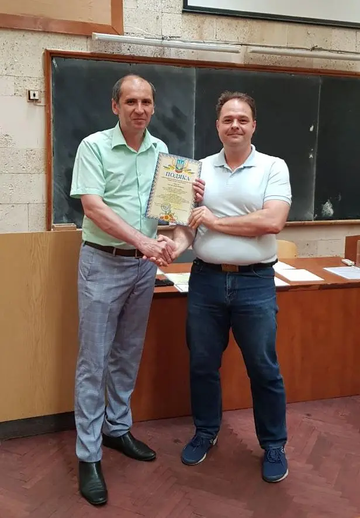

Round I of the All-Ukrainian Student Research Paper Competition in the fields of information technology; natural sciences; and electronics, automation and electronic communications has taken place.

First-degree diplomas were awarded to:

Yevhen Aizenberh, 2nd-year Master's student; supervisor: Yevhen Andriiovych Sliusar, PhD in Engineering, Assistant Professor at the Department of Computer Engineering.

Mykyta Marushchak, 1st-year Master's student; supervisor: Oleh Anatoliiovych Nedybaliuk, PhD in Physics and Mathematics, Associate Professor at the Department of Physical Electronics

Sviatoslav Hoz, 2nd-year Master's student; supervisor: Ihor Ivanovych Bekh, PhD in Physics and Mathematics, Associate Professor at the Department of Radio Engineering and Radioelectronic Systems.

Second-degree diplomas were awarded to:

Iryna Burkhan, 2nd-year Master's student; supervisor: Oleksandr Valeriiovych Barabanov, PhD in Physics and Mathematics, Associate Professor at the Department of Computer Engineering.

Dmytro Korzh, 1st-year Master's student; supervisor: Maksym Vitaliiovych Strikha, D.Sc. in Physics and Mathematics, Professor at the Department of Physical Electronics.

Yuliia Hrishaieva, 2nd-year Master's student; supervisor: Serhii Valentynovych Olshevskyi, D.Sc. in Engineering, Associate Professor at the Department of Radio Engineering and Radioelectronic Systems.

Third-degree diplomas were awarded to:

Denys Sliusarenko, 2nd-year Master's student; supervisor: Andrii Viacheslavovych Netreba, PhD in Physics and Mathematics, Associate Professor at the Department of Mathematics and Theoretical Radiophysics.

Dmytro Karakuts, 4th-year student; supervisor: Denys Dmytrovych Sheka, D.Sc. in Physics and Mathematics, Professor at the Department of Mathematics and Theoretical Radiophysics.

Kateryna Dolinchuk, 2nd-year Master's student; supervisor: Henadii Borysovych Zhyrov, PhD in Engineering, Associate Professor at the Department of Radio Engineering and Radioelectronic Systems.

We congratulate the students and their supervisors and wish them inspiration and further creative success!
