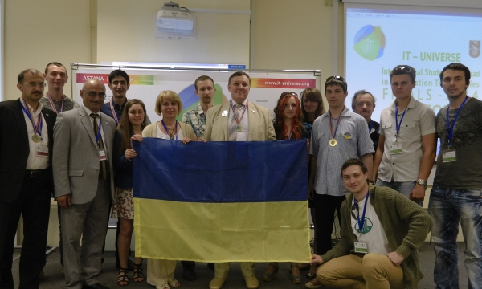

Kostiantyn Dieiev, a student of the Department of Computer Engineering, won a gold medal in the D-Link competition "Protocols, Services and Equipment".

The final of the international Olympiad in information technology "IT-Universe 2013/14" was held from 6 to 10 June 2014 in Astana (Kazakhstan). The Ukrainian team shared first place in the team standings with the team of Kazakhstan. In the six categories of the international final, Ukrainian students won 3 gold, 6 silver and 4 bronze medals.
