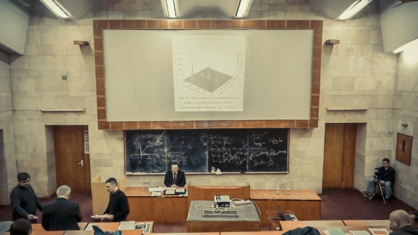

The department staff congratulate their colleague [V. V. Fedorov](#) on the successful defence of his thesis "Spectral Properties of One-Dimensional Photonic Crystals with Three Half-Wave Resonators", submitted for the academic degree of PhD in Physics and Mathematics (Candidate of Sciences) in speciality 01.04.10 "Physics of Semiconductors and Dielectrics" (supervisor: Doctor of Science in Physics and Mathematics (D.Sc.), Professor [Yu. O. Pervak](/personas/pervak/)).
