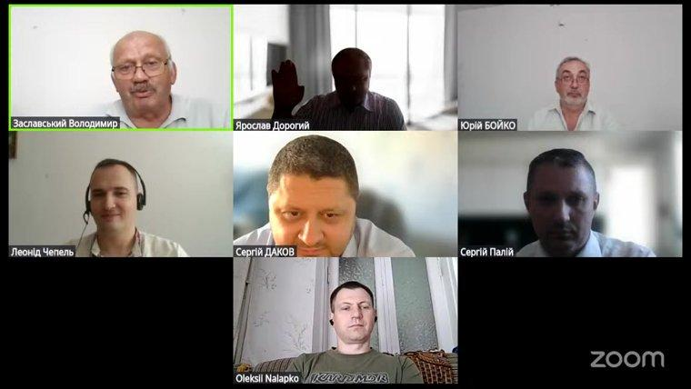
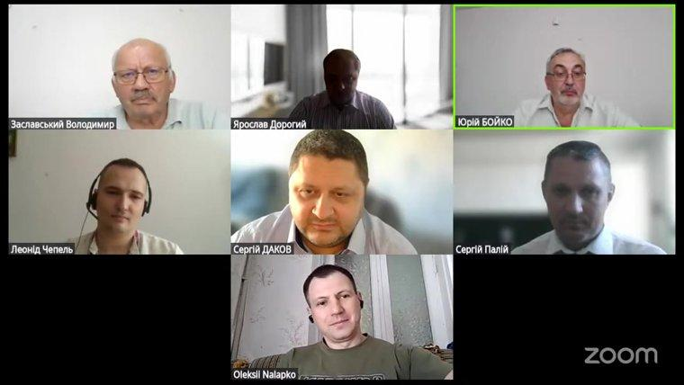
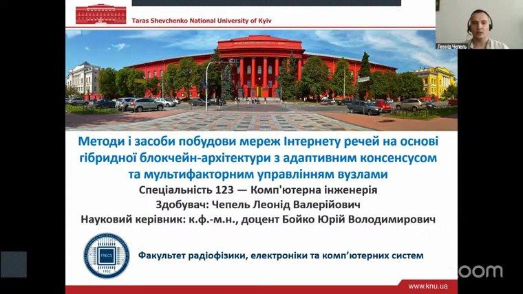
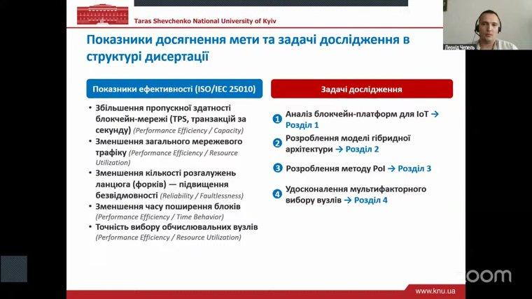
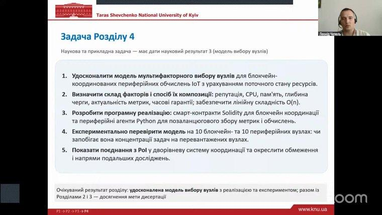

On 10 September 2026, **Leonid Chepel**, a PhD student of the Department of Computer Engineering, successfully defended his thesis "Methods and Tools for Building Internet of Things Networks Based on a Hybrid Blockchain Architecture with Adaptive Consensus and Multifactor Node Management", submitted for the degree of Doctor of Philosophy (PhD) in speciality 123 "Computer Engineering". Supervisor: PhD in Physics and Mathematics (Candidate of Sciences), Associate Professor [Yu. V. Boiko](/personas/boiko/).

The defence took place online at a meeting of the one-time specialised academic council chaired by Doctor of Science in Engineering (D.Sc.), Professor V. A. Zaslavskyi. Reviewers: S. Yu. Dakov and S. V. Palii; official opponents: Ya. Yu. Dorohyi and O. L. Nalapko.

More about the defence and the video recording: <https://scc.knu.ua/zdobuvach-phd?id=336591>

The staff of the Department of Computer Engineering congratulate Leonid Chepel on the successful completion of an important stage of his academic journey and wish him inspiration and new significant results in research on Internet of Things networks and blockchain technologies. Our sincere gratitude goes to Yurii Boiko for his supervision, support and attention to the PhD student at every stage of work on the thesis.
