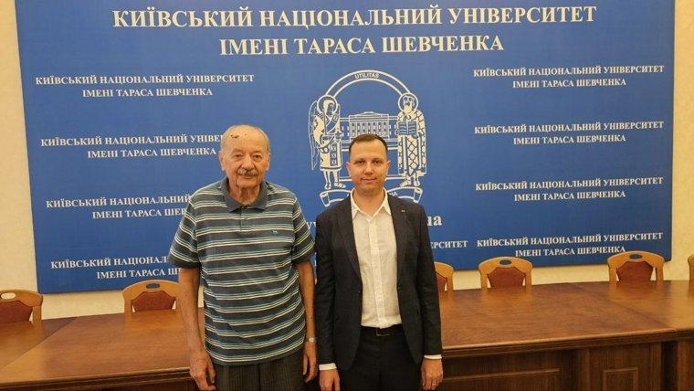
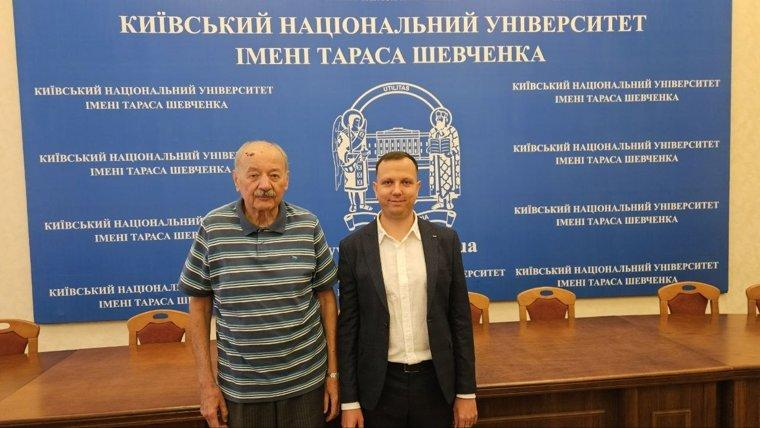
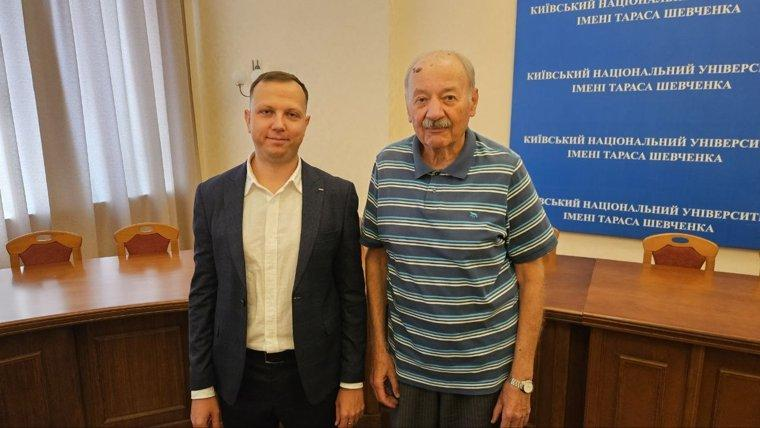
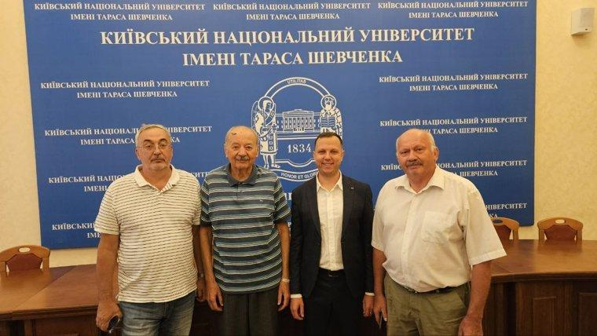
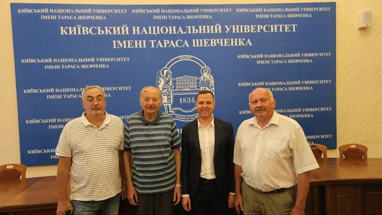

On 25 August 2026, **Bohdan Semonov**, a PhD student of the Department of Computer Engineering, successfully defended his thesis "Design and Application of Neural Networks for Creating Methods for Quality Assessment and Generation of Commit Messages in Version Control Systems", submitted for the degree of Doctor of Philosophy (PhD) in speciality 123 "Computer Engineering". Supervisor: Doctor of Science in Engineering (D.Sc.), Professor [S. D. Pohorilyi](/personas/pohorilyi/).

The defence took place in a hybrid format at a meeting of the one-time specialised academic council chaired by Doctor of Science in Engineering (D.Sc.), Professor V. A. Zaslavskyi. Reviewers: [Yu. V. Boiko](/personas/boiko/) and O. O. Marchenko; official opponents: A. M. Hlybovets and V. M. Opanasenko.

More about the defence: <https://scc.knu.ua/zdobuvach-phd?id=336579>

The Department of Computer Engineering warmly congratulates Bohdan Semonov on obtaining the degree of Doctor of Philosophy (PhD) and wishes him success in his further research, in particular in applying artificial intelligence methods to software engineering. Our thanks go to Serhii Pohorilyi for his long-standing scientific school, in which more than one generation of researchers has grown up.

Special congratulations to Professor **Serhii Pohorilyi**: Bohdan Semonov has become the **tenth** of his PhD students to successfully defend a thesis. This is a significant contribution to the training of research staff for the department and the university. We wish Serhii Pohorilyi good health, inspiration and new talented students!
