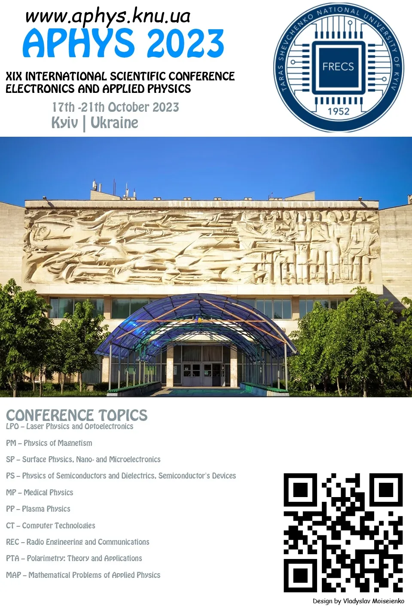

Dear Colleagues,

We cordially invite you to attend “The 19th International Conference on Electronics and Applied Physics”, which will be held ONLINE from October, 18 to 20, 2023 in Kyiv Taras Shevchenko National University at the Faculty of Radiophysics, Electronics and Computer Systems, Ukraine. The Conference provides an ideal academic platform for researchers to present the latest research findings and describe emerging technologies, and directions in Applied Physics issues.

For more details about the conference please visit our website at www.aphys.knu.ua

Your presence at the conference is important to us. We look forward to seeing you there.
