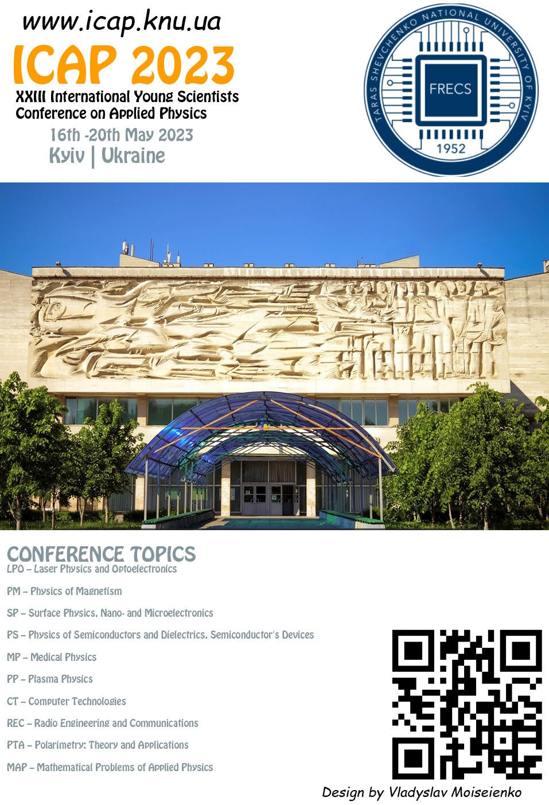

Dear Colleagues,

We would like to remind you that registration for the ICAP’2023 conference is ongoing. Please pay special attention to the conditions of participation and important dates.

“The 23th International Young Scientists’ Conference on Applied Physics ICAP 2023“, which will be held ONLINE from May, 16 to 20, 2023 in Taras Shevchenko National University of Kyiv at the Faculty of Radiophysics, Electronics and Computer Systems, Kyiv, Ukraine. The Conference provides an ideal academic platform for researchers to present the latest research findings and describe emerging technologies, and directions in Applied Physics issues.

Important Dates

1 April 2023 - deadline for registration

1 May 2023 - deadline for Abstract submission

16 May 2023 - conference opening day

Online registration made via e-mail message to <icap@knu.ua>. For registration please send information for family name of participant, section according to Scientific Program and report title.

For more details about the conference please visit our website at www.icap.knu.ua

Your presence at the conference is important to us. We look forward to seeing you there.
