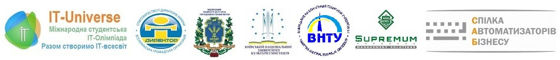

Вітаємо з офіційним відкриттям та запрошуємо до участі новому сезоні Міжнародної студентської ІТ-олімпіади IT-Universe - "IT-Universe-2023". 1 березня розпочалась реєстрація закладів вищої освіти на участь у IT-Universe. Реєстрація студентів розпочалась 15 березня. Конкурсна програма ще формується, але вже анонсовано 12 конкурсів - заходьте, знайомтесь, обирайте ті, в яких хочете прийняти участь (можна приймати участь у першому етапі декількох конкурсів).

Сподіваємось, що в цьому році нам все-таки вдасться провести очний фінал. Але "резервний план" та досвід "заочного фіналу" в нас вже є, тому й до такого варіанту ми готові :). Чекаємо Вас! Приєднуйтесь! Разом ми створимо ІТ-Всесвіт!

Більш детально про старт IT-Universe - <https://it-universe.org/blog/news/news_IT_universe.php?ELEMENT_ID=8183>
