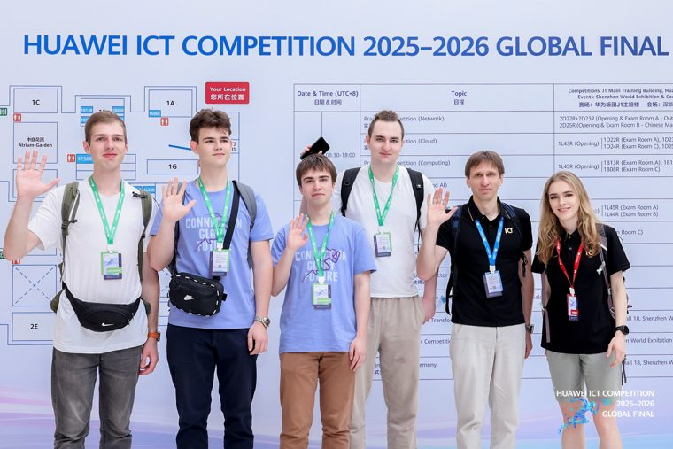
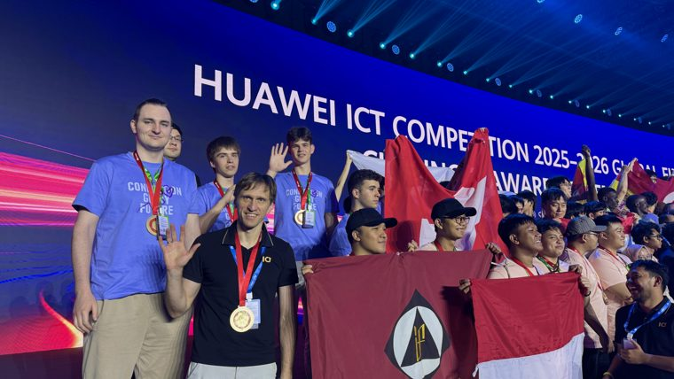
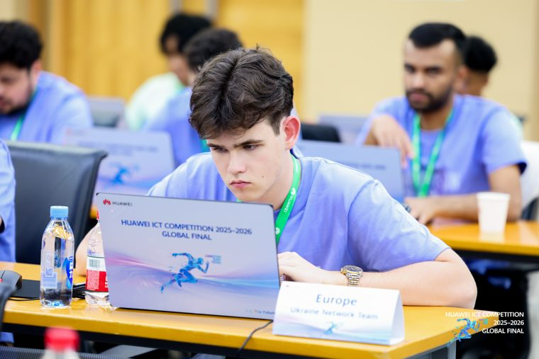
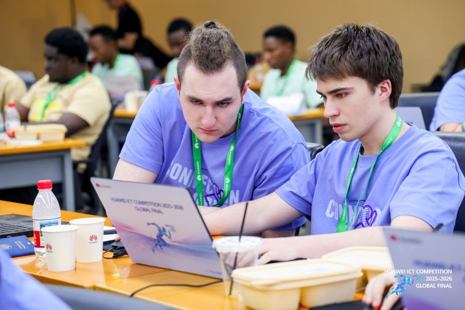
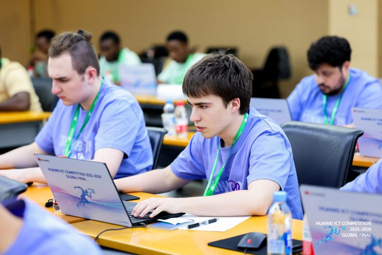
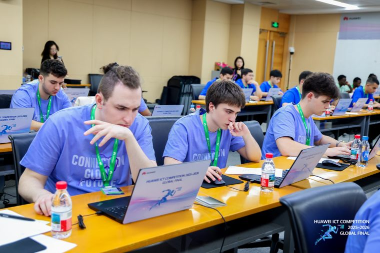
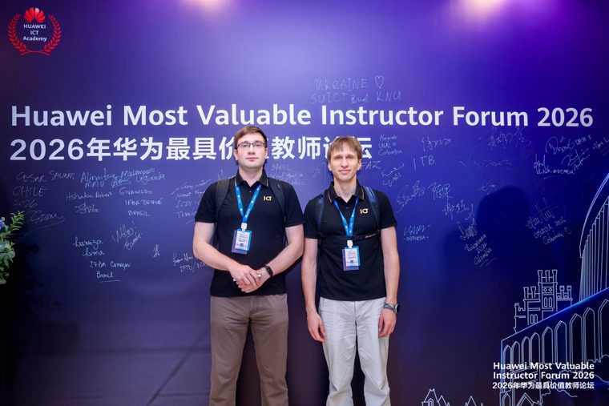
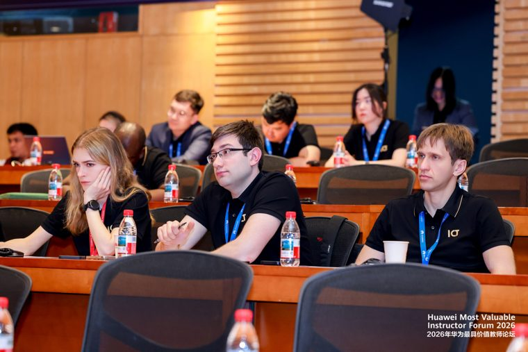
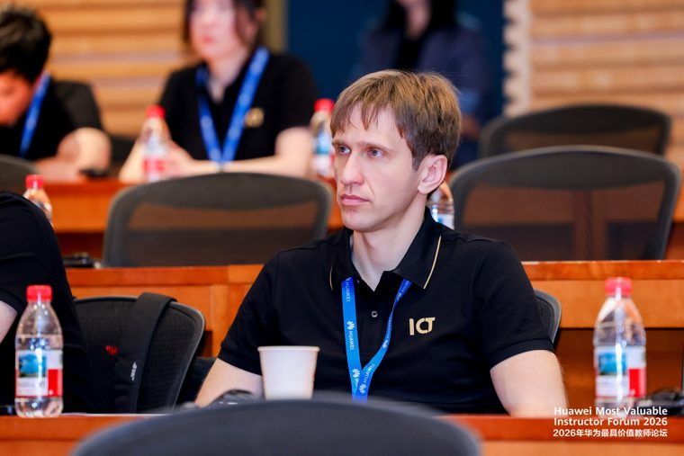

Конкурс Huawei ICT — це щорічний глобальний захід для студентів та викладачів коледжів і університетів. Він став міжнародною платформою для змагань та обміну досвідом, що дозволяє учасникам зміцнити знання в галузі ІКТ, удосконалити практичні навички та сприяти інноваціям із використанням найновіших технологій і платформ. У Китаї конкурс внесено до переліку національних змагань для студентів університетів, а у світі його визнано ключовою партнерською флагманською програмою Глобальної академії навичок ЮНЕСКО.

Дві команди Київського національного університету імені Тараса Шевченка вийшли до глобального етапу конкурсу за напрямами **Networking** та **Computing**. До глобального етапу було відібрано лише п'ять команд з європейського регіону (загалом регіонів — п'ять), причому пройти далі могла тільки найкраща команда з кожного напряму.

Здобувачі освіти нашого університету посіли призове **третє місце** в обох напрямах — Networking та Computing.

Ключову роль у досягнутих результатах відіграли наполегливість, ініціативність та напружена праця під час підготовки до змагань. Важливе значення мали також інтеграція сучасних інформаційних технологій у навчальний процес на кафедрі комп'ютерної інженерії та співпраця університету з роботодавцями й виробниками в галузі інформаційних технологій.

Детальніше про конкурс: <https://www.huawei.com/minisite/ict-competition-2025-2026-global/en/index.html>

**Фотогалерея.** Натисніть на будь-яке фото, щоб відкрити його у повній роздільній здатності.

