Команда Sinners of the networks Київського національного університету імені Тараса Шевченка посіла **перше місце** в категорії Datacom Engineering всеукраїнського командного змагання Student Tech Challenge-2026, яке проводила компанія Huawei Ukraine. Нагородження переможців відбулося 6 листопада 2026 року в Києві.

У змаганні взяли участь 42 команди з 18 університетів і 12 міст України. Конкурсні завдання виконувалися у трьох категоріях: Datacom Engineering, Digital Energy та Radio Access Network Planning. Презентації проектів перед незалежним журі відбулися 4–5 листопада 2026 року.

До складу команди увійшли студенти кафедри комп'ютерної інженерії: четверокурсники Вікторія Семенякіна, Максим Кузьменко, Андрій Пікуля та Гліб Кобрин і третьокурсник Іван Цивінський. Керівник команди — асистент кафедри, кандидат технічних наук [В. А. Мар'яновський](/personas/marianovskyi).

У категорії Datacom Engineering призові місця посіли:

- 1 місце — Sinners of the networks, Київський національний університет імені Тараса Шевченка;
- 2 місце — SYNergy, Національний університет «Львівська політехніка»;
- 3 місце — 17_channel_2.4, збірна команда Державного університету інформаційно-комунікаційних технологій та Національного університету біоресурсів і природокористування України;
- 3 місце — Cluster, Київський столичний університет імені Бориса Грінченка.

Кафедра комп'ютерної інженерії вітає команду з перемогою.

Інформація про змагання: <https://techchallenge.com.ua/>

Повідомлення Київського національного університету імені Тараса Шевченка у Facebook: [Студенти \#ТвійКНУ перемогли на всеукраїнському інженерному конкурсі Student Tech Challenge 2026](https://www.facebook.com/kyiv.university/posts/-%D1%81%D1%82%D1%83%D0%B4%D0%B5%D0%BD%D1%82%D0%B8-%D1%82%D0%B2%D1%96%D0%B9%D0%BA%D0%BD%D1%83-%D0%BF%D0%B5%D1%80%D0%B5%D0%BC%D0%BE%D0%B3%D0%BB%D0%B8-%D0%BD%D0%B0-%D0%B2%D1%81%D0%B5%D1%83%D0%BA%D1%80%D0%B0%D1%97%D0%BD%D1%81%D1%8C%D0%BA%D0%BE%D0%BC%D1%83-%D1%96%D0%BD%D0%B6%D0%B5%D0%BD%D0%B5%D1%80%D0%BD%D0%BE%D0%BC%D1%83-%D0%BA%D0%BE%D0%BD%D0%BA%D1%83%D1%80%D1%81%D1%96-student-tech/1639123161590369/).

**Фотогалерея.** Натисніть на будь-яке фото, щоб відкрити його у повній роздільній здатності.

[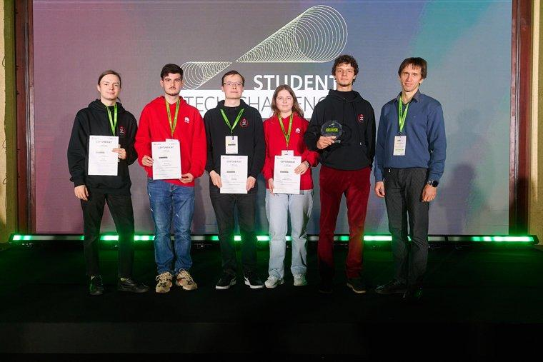](/files/stc2026/stc-2026-01.jpg)

[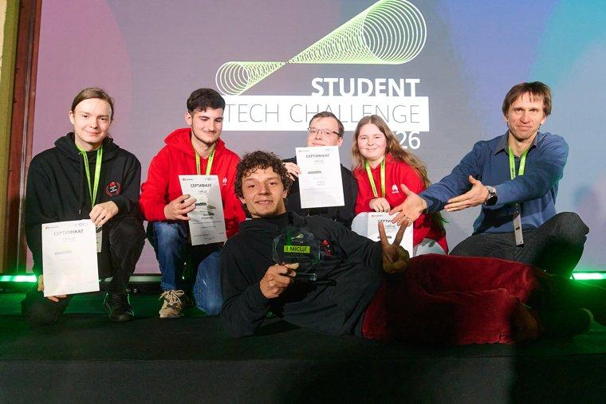](/files/stc2026/stc-2026-02.jpg)

[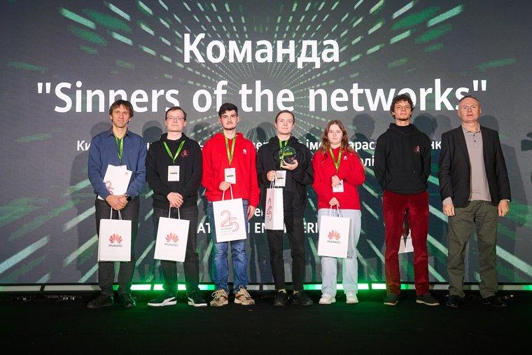](/files/stc2026/stc-2026-03.jpg)

[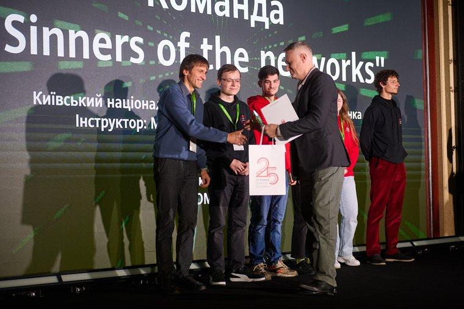](/files/stc2026/stc-2026-04.jpg)

[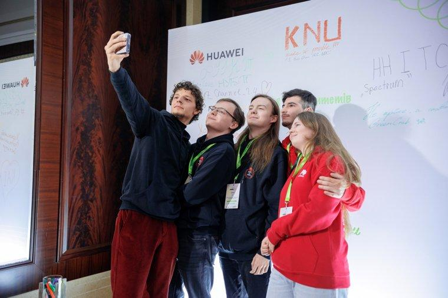](/files/stc2026/stc-2026-05.jpg)

[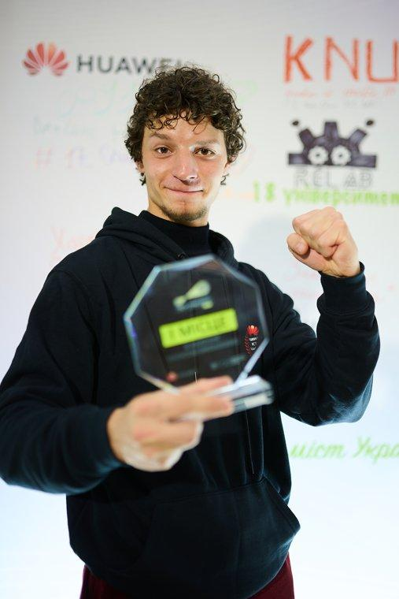](/files/stc2026/stc-2026-06.jpg)

[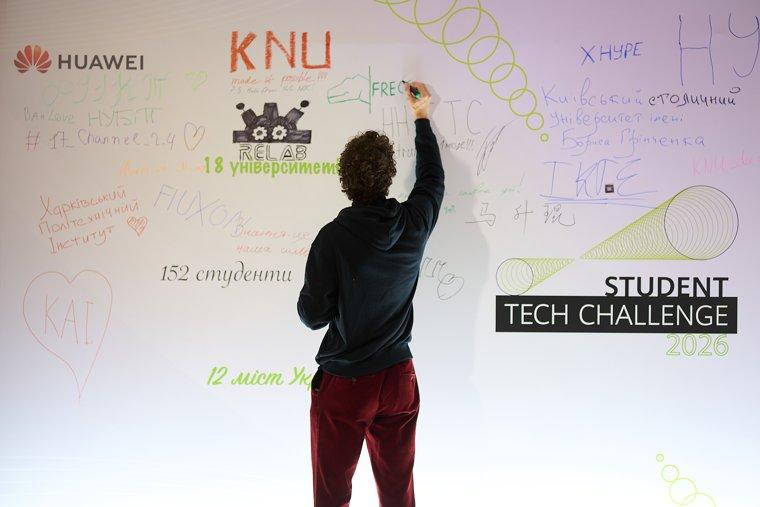](/files/stc2026/stc-2026-07.jpg)

[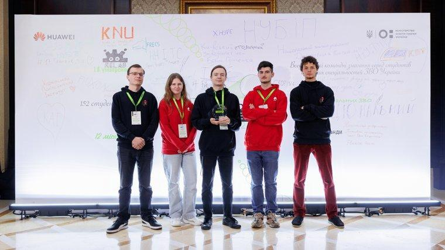](/files/stc2026/stc-2026-08.jpg)

[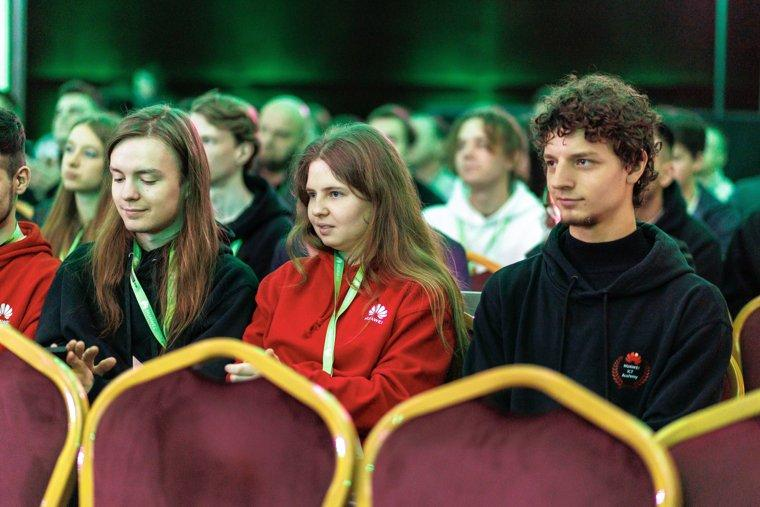](/files/stc2026/stc-2026-09.jpg)

[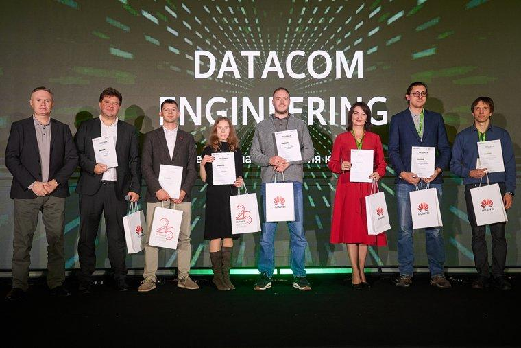](/files/stc2026/stc-2026-10.jpg)

[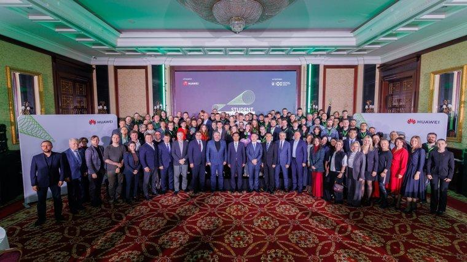](/files/stc2026/stc-2026-11.jpg)

[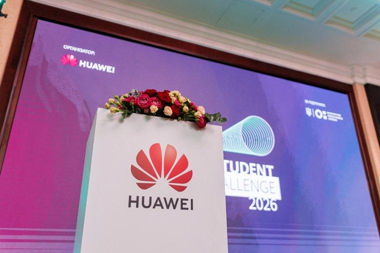](/files/stc2026/stc-2026-12.jpg)

[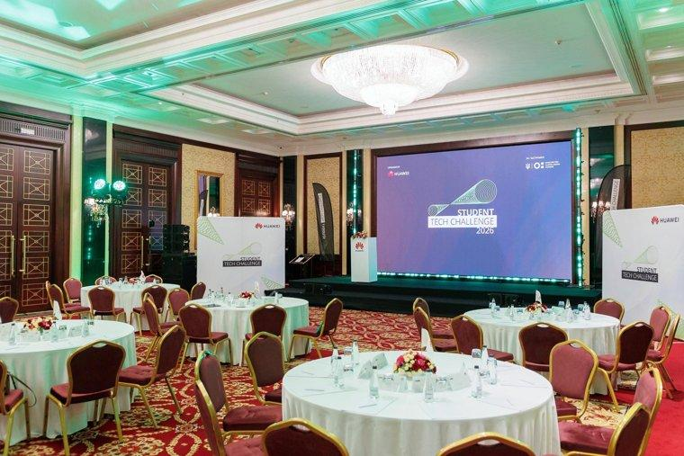](/files/stc2026/stc-2026-13.jpg)

[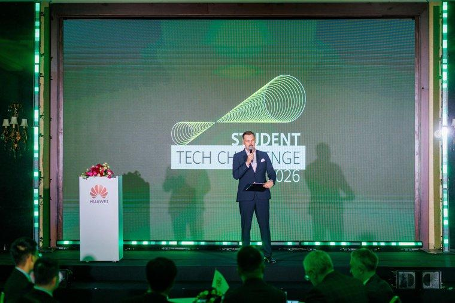](/files/stc2026/stc-2026-14.jpg)

[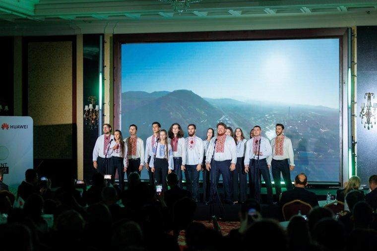](/files/stc2026/stc-2026-15.jpg)

