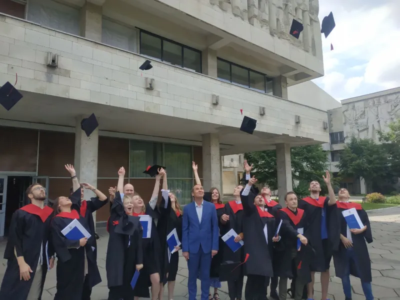

14 червня 2023 року на факультеті радіофізики, електроніки та комп’ютерних систем відбулося вручення дипломів випускникам-магістрам. Ця подія відбулася у надзвичайно урочистій, а разом з тим теплій і хвилюючій атмосфері. Свої щирі побажання випускникам факультету висловили проректор з наукової роботи Ганна Толстанова, декан факультету Андрій Нетреба, завідувачі кафедр Ігор Анісімов, Юрій Бойко, Сергій Радченко, Володимир Висоцький, Ганна Карлаш, заступники декана Наталія Башмакова, Юлія Веремій, Наталія Горбовцова, викладачі факультету. Шановні випускники! Цей день є важливим, оскільки він символізує ваші досягнення та є успішним підсумком навчання. Ваша праця та здобутки стануть фундаментом для майбутнього розвитку країни. Ми пишаємося вами! Отриманий вами диплом – це визнання вашої кропіткої праці та готовності до викликів, які чекають на вас у майбутньому. Перед вами відкриті можливості досягнення нових вершин та подальшого професійного розвитку. Щиро вітаємо вас!
