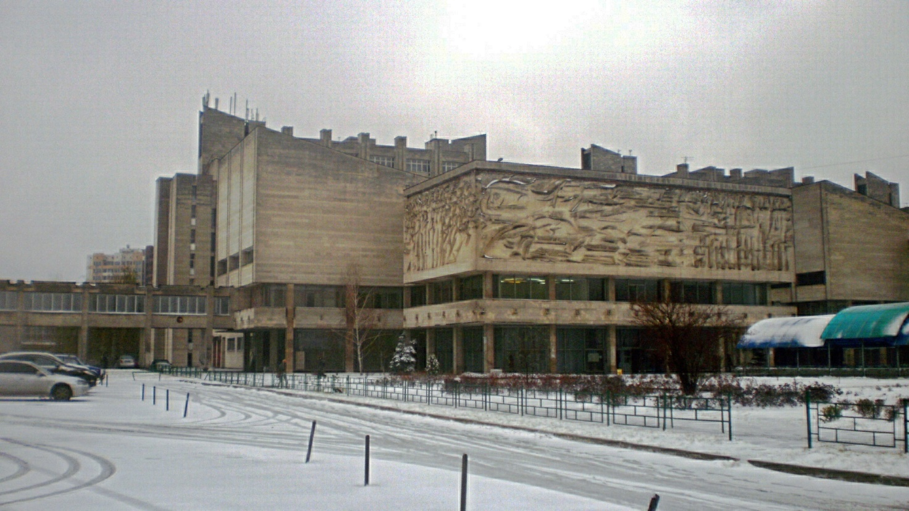

Факультет радіофізики, електроніки та комп’ютерних систем у 2 семестрі 2022/2023 навчального року планує використання змішаної форми організації навчального процесу відповідно до Наказу ректора №795-32 (<https://www.univ.kiev.ua/news/12584>) від 27.12.2022 року. У період з 23 січня до 3 лютого 2023 року навчальні заняття проводяться дистанційно з використанням інформаційно-комунікаційних технологій.
