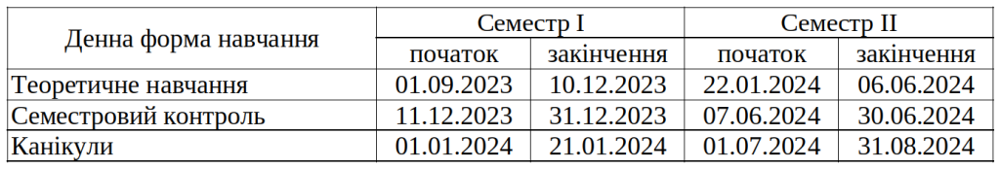

До уваги студентів інформація про організацію освітнього процесу студентів факультету радіофізики, електроніки та комп’ютерних систем у 2023-24 навчальному році.

Відповідно до графіка навчального процесу за програмами першого і другого рівнів вищої освіти на 2023/2024 н.р. Київського національного університету імені Тараса Шевченка (<https://knu.ua/ua/news/12769>):

Форма організації навчання та семестрового контролю студентів факультету у І семестрі 2023-24 н. р.

Студенти 1 і 2 курсів всіх освітніх програм освітнього рівня «Бакалавр»:

1)  аудиторна форма навчання – 01.09.2023–30.09.2023 та 20.11.23–31.12.2023;
2)  змішаний формат 01.10.2023–19.11.2023.

Студенти 3 і 4 курсів всіх освітніх програм освітнього рівня «Бакалавр»:

1)  дистанційна форма навчання – 01.09.2023–30.09.2023;
2)  аудиторна форма навчання – 01.10.23–05.11.2023 та 11.12.2023–31.12.2023;
3)  змішаний форма навчання – 06.11.2023–10.12.2023.

Студенти 1 курсу всіх освітніх програм освітнього рівня «Магістр»:

1)  аудиторна форма навчання – 01.10.2023–05.11.2023 та 11.12.2023–31.12.2023;
2)  змішаний формат 06.11.2023–10.12.2023.

Студенти 2 курсу всіх освітніх програм освітнього рівня «Магістр»:

1)  аудиторна форма навчання – 11.12.2023–31.12.2023;
2)  змішаний формат 01.09.2023–10.12.2023.
