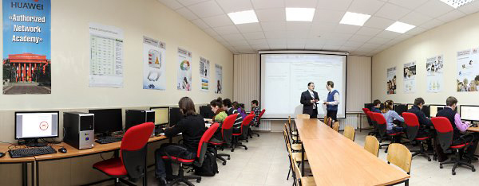
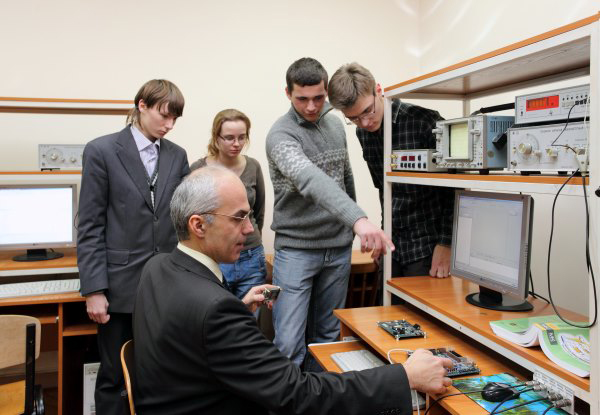
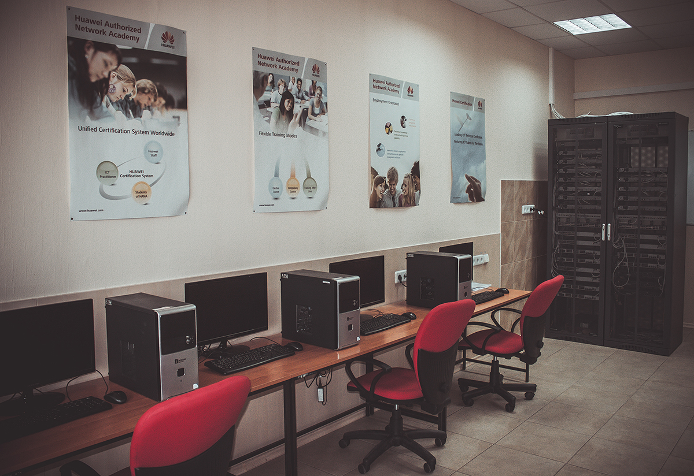
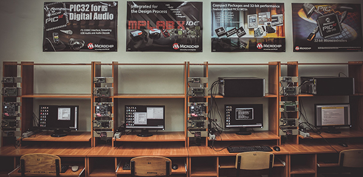
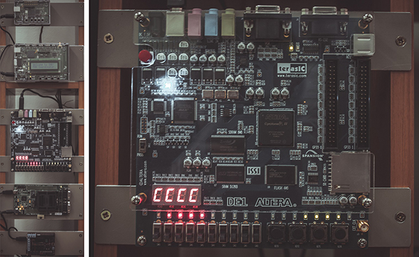
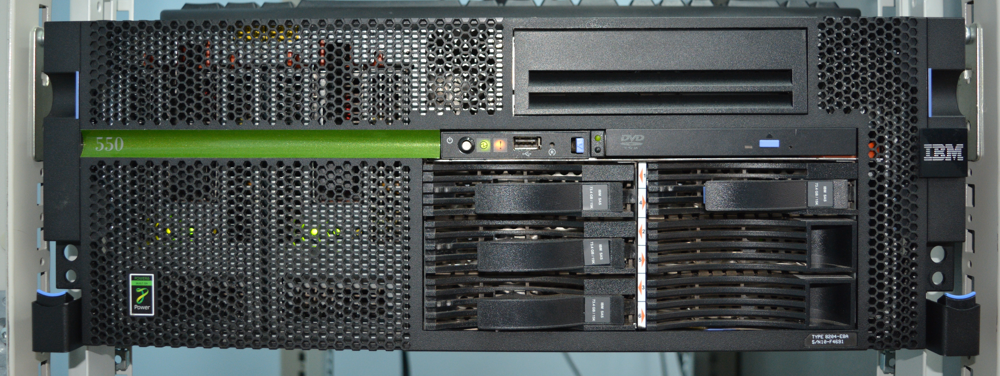
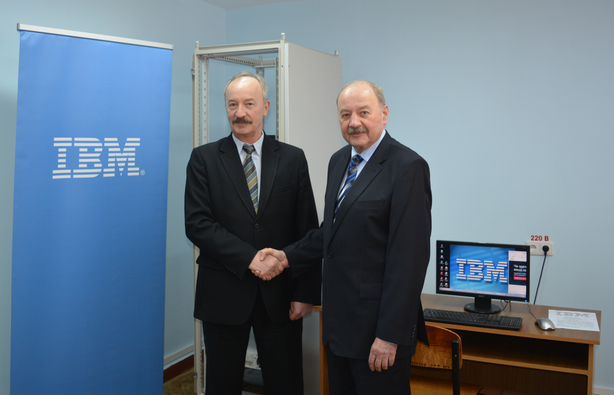
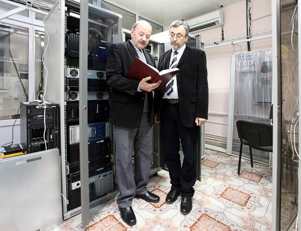

**"Computer Engineering"** covers the hardware platforms and system software of general-purpose and special-purpose computer systems and networks, as well as their components.

At Taras Shevchenko National University of Kyiv, training in speciality "F7 Computer Engineering" (field of study "F Information Technologies") is provided by the Department of Computer Engineering at the following levels of higher education:

- Bachelor's level: 4 years of study leading to the **"Bachelor"** educational degree (educational programme "Computer Systems and Networks Engineering"),
- Master's level: 2 years of study leading to the **"Master"** educational degree (educational programme "Computer Systems and Networks"),
- educational and scientific level: 4 years of study leading to the **"Doctor of Philosophy"** educational and scientific degree (educational programme "Computer Engineering")

In accordance with the licences granted by the Ministry of Education and Science of Ukraine, the Department of Computer Engineering is entitled to admit:

- **Bachelor's students** to the 1st year, up to 100 students,
- **Master's students** to the 1st year, up to 50 students,
- **PhD students** to the 1st year of study, up to 10 persons.

After completing the Bachelor's programme, students may continue their studies to obtain the "Master" degree of higher education. A Master's-level specialist has the special knowledge and skills needed to perform teaching, research and managerial functions.

The object of computer engineers' activity is the technical (hardware) means and system software of general-purpose and special-purpose computer systems and networks, and their components. Computer engineering, a combination of electronics and computer science, deals with the study of computing technology ranging from microprocessors to supercomputers. Computer engineers are research engineers who, at the department, specialise in two areas:

- **programming tools and software for resource management** (software platforms of computer systems)
- **hardware design of computing equipment** (hardware platforms of computer systems)

For this training, the department has laboratories well equipped with the necessary hardware; academies of the leading companies Huawei, Cisco and Microsoft operate here, and the department cooperates with "IBM Ukraine". Students can specialise in computer systems, system programming, computer communications, network technologies, embedded systems, pattern recognition, expert systems, multimedia systems and other areas of the IT industry.

The department's curriculum balances courses on computer systems, hardware and software with a set of fundamental disciplines in physics and mathematics, and includes a number of specialised elective courses. Graduates can continue their studies as PhD students in the field of computer engineering or choose a career related to computers and their applications in high technology.

A short list of the professional disciplines taught at the department includes: algorithms, discrete mathematics, computer systems organisation, circuits and signals, database systems, digital circuit design and electronics, digital signal processing and digital communications, embedded systems, operating systems, software development, computer networks, computer-aided design systems, social and professional issues.

While studying at the department, students can choose one of two blocks of disciplines (Bachelor's level):

- **system administration**
- **network administration**

And at the Master's level, the specialisations:

- **system engineers**
- **network engineers**

The disciplines taught within these specialisations are aimed at gaining additional knowledge in the respective fields.

History of the Department of Computer Engineering. In 1991, the specialisation "Automation of Scientific Research" was established at the Department of Radioelectronics. For the first time in Ukraine, the department launched a series of works aimed at the intensive introduction of modern computer and network technologies for the automation of physical experiments. In 1996, the Department of Semiconductor Physics was merged with the Department of Radioelectronics and was named the Department of Semiconductor Electronics. The department was headed by Professor O. V. Tretiak, Honoured Worker of Science and Technology of Ukraine and Academician of the Academy of Pedagogical Sciences of Ukraine. Under his leadership, a world-renowned school of semiconductor physics was created at the department.

From 2006, the department was headed by Associate Professor Yu. V. Boiko. In 2009, on the basis of this specialisation, the department began training specialists in computer engineering. In 2010, the department was named the Department of Computer Engineering. In 2012, S. D. Pohorilyi, D.Sc. in Engineering, Professor, became Head of the Department. Since 2021, the department has been headed by Associate Professor Yu. V. Boiko.

The priority research areas are:

- Creating a holistic, scientifically grounded methodology to support the design and use of IT infrastructure, and experimentally verifying its effectiveness.
- Developing network data transmission technologies for IoT and analysing methods for building high-performance cloud infrastructures.

The department has modern specialised equipment manufactured by HUAWEI (PRC) for data switching and routing in the network infrastructures of large enterprises, which is currently used for laboratory practicals and experimental research.

The department's Digital Communications Laboratory has modern equipment from MIPS Technologies, with which the department maintains scientific contacts. The equipment is used for laboratory and practical classes; in particular, the latest Altera DE1 boards are used in laboratory classes on digital logic, computer architecture, etc.

In spring 2017, a memorandum was signed between the Faculty of Radiophysics, Electronics and Computer Systems of Taras Shevchenko National University of Kyiv and the representative office of IBM Corporation, "IBM Ukraine". As part of this cooperation, a modern IBM Power 550 server with the AIX Unix platform was handed over to the Department of Computer Engineering for operation.

In addition to its own equipped laboratories, the Department of Computer Engineering uses in the educational process the shared resources of the university maintained by the Computing Centre (ICC). In particular: - the first high-performance computing cluster, built at the ICC with the support of Intel Corporation. This resource is also actively used for scientific research in various fields. - the highly reliable IBM Z800 mainframe - network equipment of the Cisco laboratory

