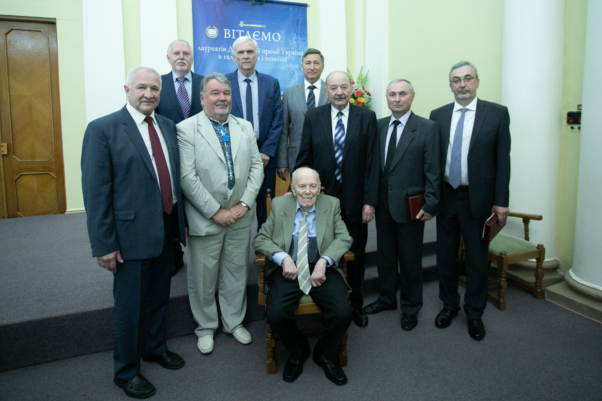
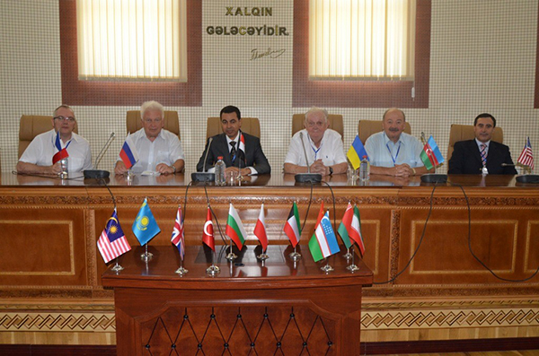
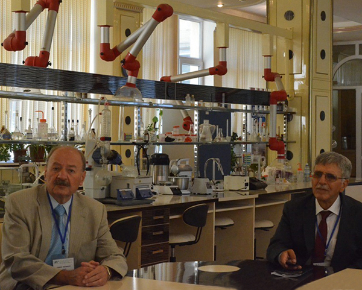
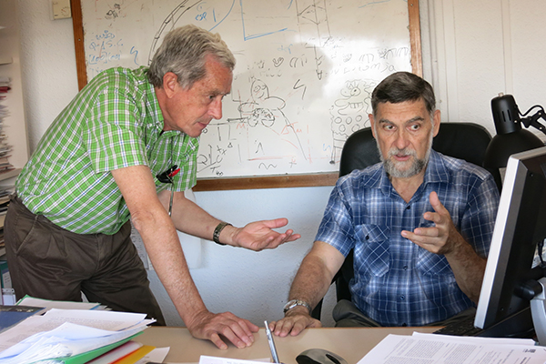
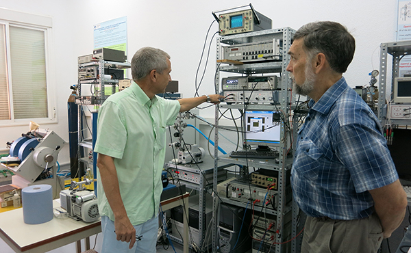
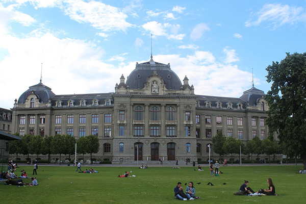
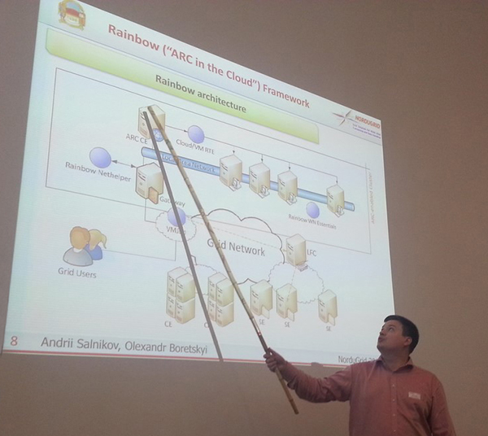
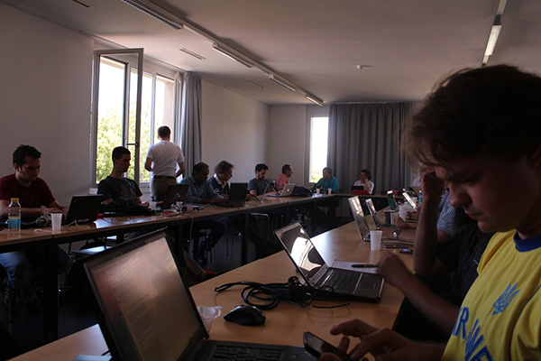
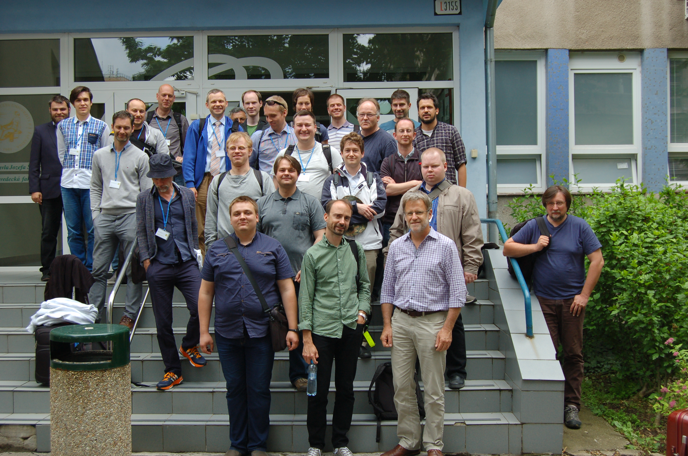
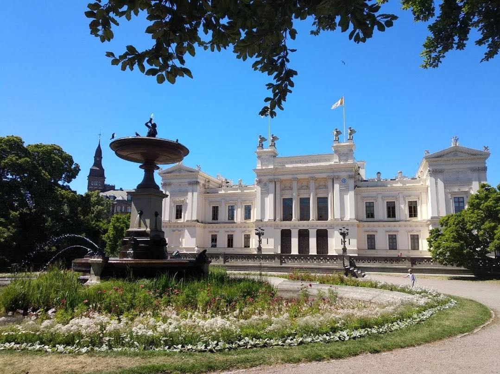

The main areas of research at the department are:

- the use of modern IT technologies to create high-performance computing and distributed systems
- novel methods for creating and studying digital communication systems
- the application of novel methods and approaches to the creation and analysis of supercomputer systems and the methodology of high-performance computing (the mathematical apparatus of modified systems of algorithmic algebras and real-time process algebra, genetic algorithms, workflow patterns, coloured Petri nets, etc.)
- artificial intelligence and machine learning: neural networks, large language models, computational linguistics and natural language processing, computer vision and image processing

For their participation in the research "Methods and Novel Approaches to the Design, Management and Application of High-Performance IT Infrastructures", two staff members of the Department of Computer Engineering (Prof. S. D. Pohorilyi and Assoc. Prof. Yu. V. Boiko) became Laureates of the State Prize of Ukraine in Science and Technology for 2018. The main result of the work is the development of a coherent, scientifically grounded methodology for supporting the processes of designing, managing and using IT infrastructure

*Professor S. D. Pohorilyi and Associate Professor Yu. V. Boiko at the award ceremony for the Laureates of the State Prize of Ukraine in Science and Technology*

For their participation in the research "Creation of a High-Performance Grid Infrastructure for Studying Conformational Changes of Biopolymers", two staff members of the Department of Computer Engineering (Assistant Professors A. O. Salnikov and Ye. A. Sliusar) became laureates of the President of Ukraine's Prize for Young Scientists for 2018. The main result of the work is the creation of an integrated information and computing platform, which has significantly increased the efficiency of computations in computer studies of biological macromolecules and their complexes.

Research papers by the department's teaching and research staff are published in leading international and specialised journals, such as "Applied and Computational Mathematics" (ISSN 1683-3511), "Proceedings of the Institute of Applied Mathematics" (ISSN 2225-0530), "Mathematical Machines and Systems", "Problems in Programming", "Cybernetics and Systems Analysis", "Bulletin of Taras Shevchenko National University of Kyiv, Series: Physics and Mathematics", "Ukrainian Journal of Physics", "Journal of Automation and Information Sciences", "International Journal of Computing", "Instruments and Experimental Techniques", "Physical Review B", and others.

Two lecturers of the Department of Computer Engineering (Professors V. A. Lvov and S. D. Pohorilyi) are members of specialised academic councils (D 26.001.09, D 26.248.01, D 11.184.01), one lecturer is a member of the Expert Council on Informatics, Cybernetics and Instrument Engineering of the State Accreditation Commission of the Ministry of Education and Science of Ukraine, and one lecturer (Associate Professor Yu. V. Boiko) is a member of the Scientific and Methodological Commission on the Informatisation and Computerisation of Educational Institutions (Division of Preschool and General Secondary Education).

The department's main research projects:

- the first computing cluster (supercomputer) in Ukraine was created and put into operation to solve problems in the fundamental and applied sciences that require large amounts of machine time and handle large volumes of information
- the first segment of the Ukrainian Academic Grid resources was created and populated, uniting 5 computing clusters of Taras Shevchenko National University of Kyiv and institutes of the National Academy of Sciences of Ukraine
- using the mathematical apparatus of systems of algorithmic algebras, a schematology was created for parallel versions of the most widely used routing algorithms (in the RIP, OSPF and other protocols) in large enterprise networks, intranets and the Internet
- tools were created for modelling and evaluating such algorithms

## International Scientific Conferences

Both lecturers and students of the Department of Computer Engineering take an active part in international scientific conferences.

In recent years, young scientists of the department have taken part in a number of international conferences held in Germany, Finland, Sweden, Switzerland, Azerbaijan, and elsewhere. In particular:

- UkrPROG International Scientific and Practical Conferences on Programming;
- International Conferences on Control and Optimization with Industrial Applications (COIA);
- IEEE International Conference on Advanced Trends in Information Theory (ATIT);
- The IEEE International Conference on System Analysis & Intelligent Computing (SAIC).
- International Conferences on Computer Science and Information Technologies,
- The annual international NorduGrid conference
- Intelligent Data Acquisition and Advanced Computer Systems (IDAACS)

From 27 to 29 August 2015, Baku University (Azerbaijan) hosted the Fifth International Conference COIA 2015 (Control and Optimization with Industrial Applications), at which Professor S. D. Pohorilyi presented a paper on a combinatorial optimisation method.

 and S. D. Pohorilyi")

Since 2000, Professor V. A. Lvov has been collaborating with the University of the Balearic Islands (Spain). At the invitation of the UIB Board of Governors, he has made 7 visits as a full professor.

Department staff members A. O. Salnikov and Ye. A. Sliusar, PhDs in Engineering, take part in the annual international NorduGrid conferences and in technical meetings on the development of the Advanced Resource Connector software for building grid infrastructures, where they present results obtained in creating the Ukrainian National Grid.

