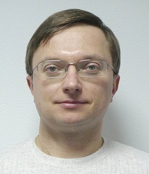
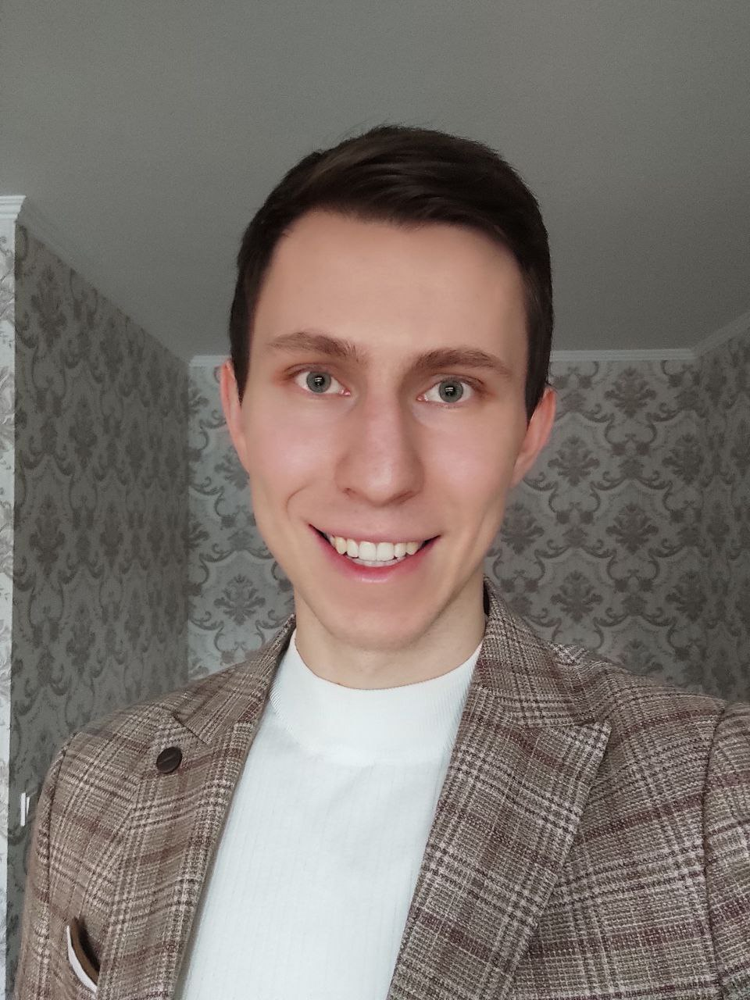
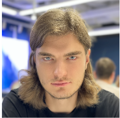

<!-- sections -->

## Дмитро Калита

*Директор представництва корпорації Intel по Україні, Білорусі і Молдові з 2014 по 2017 роки.*

> У сучасному світі високих технологій знання – це постійний пошук нового.

<!-- fold: Розповідь Дмитра Калити -->

### Основна інформація

Закінчив магістратуру радіофізичного факультету на кафедрі напівпровідникової електроніки у 1998 р. З 1998 по 2001 рр. навчався в аспірантурі факультету (науковий керівник – професор С. Д. Погорілий) та викладав курси: «Основи комп’ютерних мереж» та «Об’єктно-орієнтоване програмування» для магістрів. Автор кількох наукових праць, посібника та співавтор двох видань підручника «Комп’ютерні мережі», який має гриф МОН України.

Хоббі: сучасна музика, мандрівки та гаджети.

### Побажання для абітурієнтів та студентів

Освіта та проведений в Київському національному університеті час, навчили мене не просто механічно підставляти цифри до формул та працювати від 8-ї до 17-ї, а мислити та вирішувати нестандартні завдання. У сучасному світі високих технологій знання – це постійний пошук нового. Саме цьому і навчають на кафедрі комп’ютерної інженерії факультету радіофізики, електроніки та комп’ютерних систем.

Інформаційні технології за остання 20 років пройшли надзвичайно довгий шлях. Зараз це навіть не прості та зрозумілі пристрої на системи – це частина життя кожної сучасної людини. Знання перетворились на сучасну кров економіки всього світу. Ступінь магістра та сучасну базу знань, отримані на факультеті, дозволили мені швидко знайти цікаву роботу та перевести потенціал класичної освіти до прикладного рівня повсякденної праці.

Хочу підкреслити, що саме класична освіта університету та старання мого наукового керівника дозволили з часом зрозуміти, що не самі знання, а розуміння та вміння правильно користуватися процесом пізнання і є головною конкурентною перевагою у житті. Покоління електроніки та комп’ютерів змінюються кожного року, а базові принципи залишаються стабільними на довгі роки.

Завдяки університету, я знаю як працюють транзистори, як вимірюються величини та будуються датчики, як створюється схемотехніка, за що відповідають різні частини комп’ютерних систем, де і для чого використовуються різноманітні алгоритми, принципи побудови обчислювальних мереж – це і є необхідна основа для моєї теперішньої роботи.

Процес опанування та продажу на ринку нових найсучасніших технології вимагає розуміння глибинних принципів та швидкої реакції. За 6 років навчання більша половина прикладних знань в ІТ може застаріти, тому тільки постійна самоосвіта та пошук знань зможе зберегти конкурентну перевагу людини в сучасному світі.

### Чим відрізняється «Комп’ютерна інженерія» від «Програмної інженерії»?

Професійна підготовка у галузі комп’ютерної інженерії – це знання та практичні навички проектування програмного забезпечення комп’ютерних систем та електроніки (апаратних засобів комп’ютерних систем та мереж). Комп’ютерні інженери займаються проектуванням апаратно-програмних комплексів, починаючи від вбудованих систем на базі мікропроцессорів, закінчуючи суперкомп’ютерами, високопродуктивними високодоступними системами та Cloud-платформами.

Програмна інженерія вивчає способи анілізу, проектування, реалізації та тестування програмного забезпечення спираючись на математичний апарат дискретної математики, алгоритмічних алгебр, функціонального аналізу, тощо. Програмні інженери займаються розробкою моделей та методів розробки програмного забезпечення – від теорії до практики створення програмних засобів.

Область комп’ютерної інженерії зосереджена не тільки на окремих аспектах програмування, компьютерних систем та мереж, а і на їх інтеграції в існуючі IT-інфраструктури.

Область програмної інженерії зосереджена на питаннях теорії та практики процесу розробки програмного забезпечення, в більшості випадків без прив’язки до існуючих IT-інфрастуруктур та рішень.

### Ким працюють випускники кафедри?

Випускники працюють програмістами, інженерами тестування програмного забезпечення, зокрема у сферах вбудованих пристроїв, високопродуктивних обчислень та мережевих застосувань.

## Артем Крамов

*Інженер-дослідник в галузі обробки природної мови, One AI Inc., Тель Авів, Ізраїль*

> …важливим є не тільки кінцевий результат, але й шлях, який було пройдено для його досягнення.

<!-- fold: Розповідь Артема Крамова -->

### Основна інформація

Тематика задач пов’язана із застосуванням засобів штучного інтелекту для автоматизованого аналізу текстів різних мов (англійська, французька, іврит): створення анотацій статей та розмов, пошук ключових речень, аналіз когерентності україномовних текстів та емоційної складової документів тощо.

З 2011 по 2017 рр. навчався на кафедрі комп’ютерної інженерії факультету радіофізики, електроніки та комп’ютерних систем Київського національного університету імені Тараса Шевченка; отримав дипломи бакалавра та магістра з відзнакою. З 2017 по 2021 рр. навчався в аспірантурі кафедри комп’ютерної інженерії (науковий керівник – доктор технічних наук, професор Погорілий Сергій Дем’янович); в 2022 році отримав ступінь доктора філософії в галузі знань «Інформаційні технології». Основний напрямок наукових досліджень полягав у дослідженні та створенні сучасних методів обробки текстів української мови за допомогою різнотипних засобів штучного інтелекту (глибоких нейронних мереж, моделей машинного навчання). Автор більше 20 наукових праць, з яких 9 робіт проіндексовано наукометричною базою даних Scopus (індекс Гірша – 3), 3 роботи – базою даних Web of Science (індекс Гірша – 1).

Хобі: подорожі, науково-популярна література з психології, східні єдиноборства.

### Побажання для абітурієнтів та студентів

Незважаючи на сучасну тенденцію до насамперед прикладного вивчення основ інформаційних технологій, фундаментальні знання залишаються одним з ключових критеріїв формування висококваліфікованого фахівця в галузі комп’ютерної інженерії. Розуміння основ схемотехніки, сучасних методів програмування, теорії алгоритмів чи елементів математичного аналізу, які викладаються в межах класичної освіти університету, є критично важливим кроком на шляху подальшого опановування та створення новітніх методів водночас комп’ютерної інженерії, а також низки суміжних галузей.

Поєднання фундаментальних знань, розуміння сучасних технологій, вміння вчитися та прагнення до постійної самоосвіти дозволяють вирізняти фахівців високого рівня серед інших кандидатів на сучасному ринку праці в галузі інформаційних технологій. Крім отримання зазначених навиків, навчання на кафедрі комп’ютерної інженерії дозволило зрозуміти наступне: важливим є не тільки кінцевий результат, але й шлях, який було пройдено для його досягнення. Тому відомий латинський вислів «Per aspera ad astra» («Крізь терни до зірок») завжди буде супроводжувати та надихати випускників кафедри Комп’ютерної інженерії для досягнення чергової мети.

## Максим Слинько

*Менеджер з програмних проєктів компанії Lyft*

> “Навчитися вчитися” - на мою думку, це один з найголовніших здобутків випускників кафедри.

<!-- fold: Розповідь Максима Слинька -->

### Основна інформація

Закінчив магістратуру факультету радіофізики, електроніки та комп’ютерних систем у 2016 р. Захистив дисертацію доктора філософії на кафедрі комп’ютерної інженерії у 2020 р. (науковий керівник - доктор технічних наук, професор С. Д. Погорілий) та приймав участь у викладанні курсів: “Дискретна математика” та “Інтерфейси систем обміну даними” для бакалаврів та магістрів. Маю великий досвід розробки програмного забезпечення в різних галузях, зокрема робототехніки та цифрової криміналістики.

### Побажання для абітурієнтів та студентів

Класична освіта є конче важливою для інженерів, так як вона надає цінні навички критичного мислення і аналізу, які є необхідними для розв’язування складних технічних проблем. Інженери повинні вміти аналізувати різні можливі рішення і вибирати найефективніше. Крім того, вони повинні володіти математичними навичками, які надаються в класичній освіті, щоб мати здатність розраховувати складні системи і навантаження на структури.

Я отримав багато прикладних навичок під час навчання на кафедрі комп’ютерної інженерії - мови програмування різних рівнів, алгоритми, засади побудови штучного інтелекту, принципи комп’ютерних мереж тощо. Втім, галузь інформаційних технологій розвивається швидкими темпами. Не варто думати, що навчання завершиться у момент отримання диплому. “Навчитися вчитися” - на мою думку, це один з найголовніших здобутків випускників кафедри. Це забезпечується як на базовому рівні - при проходженні освітніх програм, так і на просунутому - при роботі над дослідницькими програмами кафедри.

Так, можливо випускникам доведеться працювати з іншими мовами програмування, аніж під час навчання, або з іншою апаратною базою, але підходи та вміння знаходити критичні точки та фокусуватися на найголовнішому залишаться з вами назавжди. Наприклад, протягом своєї кар’єри я багато разів користувався знаннями дискретної математики, отриманими під час навчання - не лише для спрощення програмного коду, а і для виявлення прихованих правил бізнес-логіки. Щоразу це давало мені конкурентну перевагу.

Навчання в аспірантурі та захист дисертації на кафедрі комп’ютерної інженерії заклали міцний фундамент розвитку моєї кар’єри. Наші викладачі - справжні професіонали своєї справи, здатні підготувати студентів до викликів, що їх очікують в сучасному світі.
