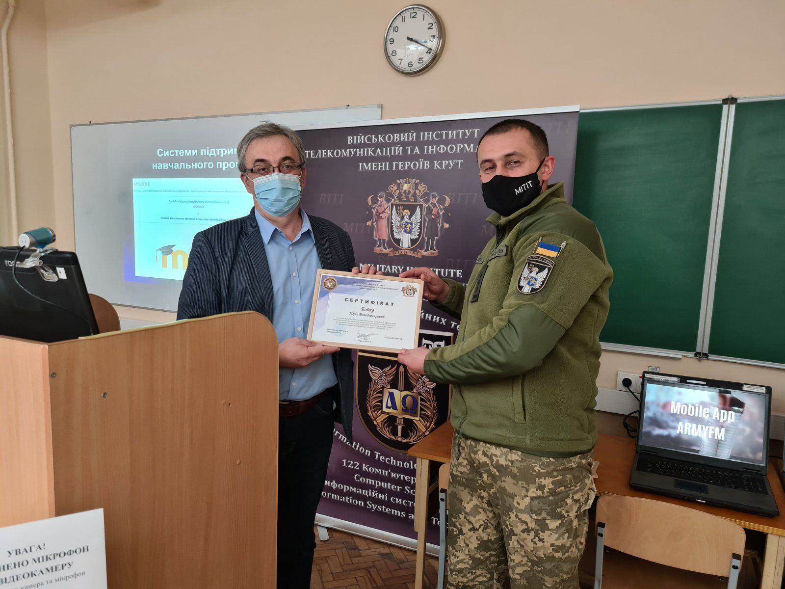

## Напрями досліджень

Основними напрямами наукової роботи на кафедрі є:

- використання сучасних ІТ-технологій для створення високопродуктивних обчислювальних і розподілених систем
- новітні методи створення та дослідження систем цифрового зв’язку
- застосування новітніх методів і підходів для створення та аналізу суперкомп’ютерних систем і методології високопродуктивних обчислень (математичний апарат модифікованих систем алгоритмічних алгебр і алгебри процесів реального часу, генетичні алгоритми, шаблони потоків робіт і кольорові мережі Петрі тощо)
- штучний інтелект і машинне навчання: нейронні мережі, великі мовні моделі, комп’ютерна лінгвістика й обробка природної мови, комп’ютерний зір і обробка зображень

## Основні наукові проекти кафедри

- створено та введено в експлуатацію перший в Україні обчислювальний кластер (суперкомп’ютер) для вирішення задач в галузях фундаментальних та прикладних наук, що потребують великих витрат машинного часу та оперують великими об’ємами інформації
- створено та наповнено перший сегмент Українських академічних грід-ресурсів, що об’єднав 5 обчислювальних кластерів Київського національного університету імені Тараса Шевченка та інститутів НАН України
- за допомогою математичного апарату систем алгоритмічних алгебр створено схематологію паралельних найбільш поширених алгоритмів маршрутизації (в протоколах RIP, OSPF тощо) в мережах великих підприємств, Intranet-мережах та Internet
- створено інструментальні засоби моделювання та оцінки таких алгоритмів

## Премії

За участь у наукових дослідженнях «Методи та новітні підходи до проектування, управління і застосування високопродуктивних IT-інфраструктур» два співробітники кафедри комп’ютерної інженерії (проф. С.Д.Погорілий, доц. Ю.В.Бойко) стали лауреатами Державної премії України в галузі науки і техніки 2018 року. Головним результатом роботи є формування цілісної науково обґрунтованої методології підтримки процесів проектування, управління і використання ІТ-інфраструктури

*Професор С.Д. Погорілий та доцент Ю.В. Бойко під час нагородження лауреатів Державної премії України в галузі науки і техніки*

За участь у наукових дослідженнях «Створення високопродуктивної інфраструктури в грід для досліджень конформаційних змін біополімерів» два співробітники кафедри комп’ютерної інженерії (асистенти А.О.Сальніков і Є.А.Слюсар) стали лауреатами премії Президента України для молодих вчених 2018 року. Головним результатом роботи є створення інтегрованої інформаційно-обчислювальної платформи, що дозволило значно підвищити ефективність обчислень у комп'ютерних дослідженнях біологічних макромолекул та їхніх комплексів.

<!-- fold -->

## Публікації й вчені ради

Наукові статті викладачів і співробітників кафедри друкуються в провідних міжнародних і фахових журналах, таких як «Applied and Computational Mathematics» (ISSN 1683-3511), «Proceedings of the Institute of Applied Mathematics» (ISSN 2225-0530), «Математичнi машини i системи», «Проблеми програмування», «Кибернетика и системный анализ», «Вісник Київського університету, серія: фізико-математичні науки», «Український фізичний журнал», «Journal of Automation and Information Sciences», «International Journal of Computing», «Instruments and Experimental Techniques», «Physical Review B» тощо.

Двоє викладачів кафедри комп’ютерної інженерії (професори В. А. Львов і С. Д. Погорілий) є членами спеціалізованих вчених рад (Д 26.001.09, Д 26.248.01, Д 11.184.01), один викладач є членом Експертної ради ДАК МОН України з питань інформатики, кібернетики та приладобудування, один викладач (доцент Ю. В. Бойко) є членом науково-методичної комісії інформатизації та комп’ютеризації закладів освіти (відділення дошкільної та загальної середньої освіти).

<!-- fold -->

## Міжнародні наукові конференції

Активну участь у міжнародних наукових конференціях беруть як викладачі, так і студенти кафедри комп’ютерної інженерії.

За останні роки молоді вчені кафедри приймали участь у роботі ряду міжнародних конференцій, що проходили в Німеччині, Фінляндії, Швеції, Швейцарії, Айзерабайджані, тощо. Зокрема:

- Міжнародні науково-практичні конференції з програмування УкрПРОГ;
- International Conferences on Control and Optimization with Industrial Applications (COIA);
- IEEE International Conference on Advanced Trends in Information Theory (ATIT);
- The IEEE International Conference on System Analysis & Intelligent Computing (SAIC).
- International Conferences on Computer Science and Information Technologies,
- Щорічна міжнародна конференція NorduGrid
- Intelligent Data Acquisition and Advanced Computer Systems (IDAACS)

В Бакінському університеті (Азербайджан) з 27 по 29 серпня 2015 р. відбулася п’ята міжнародна конференція COIA 2015 (Control and Optimization with Industrial Applications), на якій професором С. Д. Погорілим було представлено доповідь з методу комбінаторної оптимізації.

 та С. Д. Погорілий")

Починаючи з 2000 р. й дотепер, професор В. А. Львов співпрацює з Університетом Балеарських островів (Іспанія). На запрошення Ради правління UIB він здійснив 7 візитів на умовах повного професора.

Співробітники кафедри, кандидати технічних наук А. О. Сальніков та Є. А. Слюсар приймають участь в роботі щорічних міжнародних конференцій NorduGrid та технічних нарад з питань розвитку програмного забезпечення для побудови грід-інфраструктур Advanced Resource Connector, де представляють результати отримані при створенні Українського національного грід.

